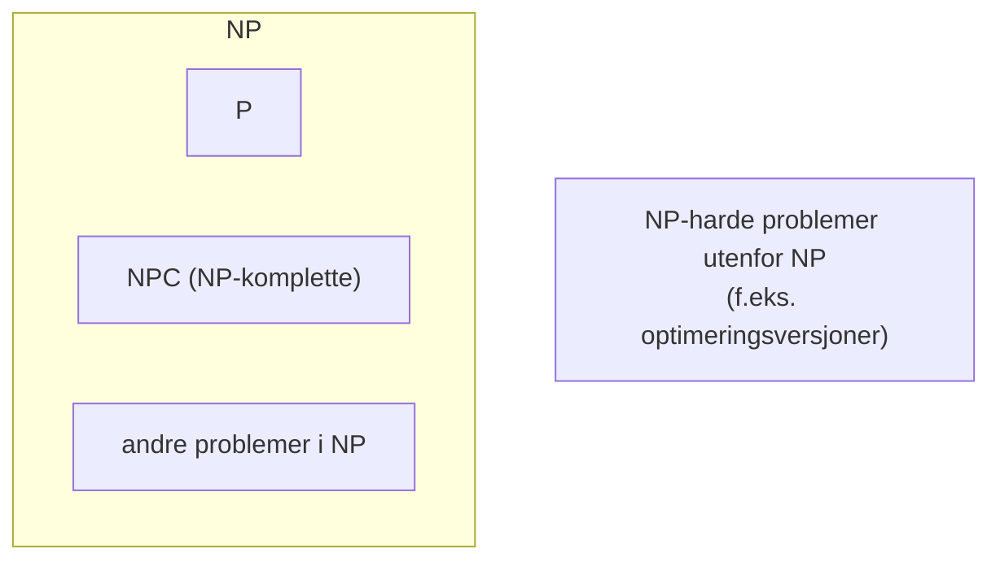

# 12. NP-kompletthet

NP er den enorme klassen av ja-nei-problemer der hvert ja-svar har et bevis som kan sjekkes i polynomisk tid. Alle problemer i NP kan reduseres i polynomisk tid til de **NP-komplette** problemene. Dermed kan ingen av disse løses i polynomisk tid, med mindre alt i NP kan det. Ingen har klart det så langt, og de fleste tror det er umulig. Denne kategorien handler om å forstå klassene og om å *bevise* at et problem er NP-komplett, slik at du vet når du ikke bør lete etter en effektiv algoritme.

**Læringsmål fra F13**

- [M1] Forstå koding (encoding) av en instans
- [M2] Forstå hvorfor løsningen på det binære ryggsekkproblemet ikke er polynomisk
- [M3] Forstå forskjellen på konkrete og abstrakte problemer
- [M4] Forstå representasjonen av beslutningsproblemer som formelle språk
- [M5] Forstå definisjonen av klassene P, NP og co-NP
- [M6] Forstå redusibilitets-relasjonen som relativ vanskegrad
- [M7] Forstå definisjonen av NP-hardhet og NP-kompletthet
- [M8] Forstå forholdet mellom NP-hardhet/NP-kompletthet og ulike problemtyper (søk, beslutning, optimering)
- [M9] Forstå den konvensjonelle hypotesen om forholdet mellom P, NP og NPC
- [M10] Forstå reduksjon begge veier mellom optimering og terskling
- [M11] Forstå reduksjon begge veier mellom søk og beslutning
- [M12] Forstå beviset for at CIRCUIT-SAT er NP-komplett (ikke grundig)

**Læringsmål fra F14**

- [N1] Forstå hvordan NP-kompletthet kan bevises ved én reduksjon
- [N2] Kjenne de NP-komplette problemene CIRCUIT-SAT, SAT, 3-CNF-SAT, CLIQUE, VERTEX-COVER, HAM-CYCLE, TSP og SUBSET-SUM
- [N3] Forstå NP-kompletthetsbevisene for disse problemene (ikke grundig)
- [N4] Forstå at det binære ryggsekkproblemet er NP-hardt
- [N5] Forstå at lengste-enkle-vei-problemet er NP-hardt
- [N6] Kjenne generelle reduksjonsstrategier og kunne konstruere enkle bevis for NP-hardhet og NP-kompletthet

**Pensum:** kap. 34, innledning og 34.1–34.5, og appendiks E i pensumheftet. Appendiks B.2 er støttelitteratur.

!!! tip "Ukens snubletråd (begge uker)"
    Om vi vil vise at X er vanskelig, må vi redusere **til** X! En reduksjon fra et kjent vanskelig problem Y til X sier: «kunne vi løst X effektivt, kunne vi løst Y effektivt». Det ville vært for godt til å være sant, så X må være minst like vanskelig som Y.

## Problemer, koding og språk (M1, M3, M4)

**Abstrakte problemer (M3).** Et abstrakt problem Q er en binær relasjon mellom en mengde **instanser** I og en mengde **løsninger** S. Et **beslutningsproblem** har bare løsningene ja og nei (1 og 0), og kan sees som en funksjon Q : I → {0, 1}. Teorien om NP-kompletthet handler om beslutningsproblemer, men optimeringsproblemer kan nesten alltid omformuleres (se M10).

> Eksempel: SHORTEST-PATH er et optimeringsproblem. Beslutningsversjonen PATH spør: gitt G, u, v og k, finnes det en sti fra u til v med høyst k kanter?

**Koding (M1).** En datamaskin jobber med bitstrenger, så instansene må kodes. En **koding** er en funksjon e : I → {0, 1}*. Et **konkret problem** er et problem der instansene er bitstrenger. Algoritmen løser det konkrete problemet e(Q), og kjøretiden måles i **lengden av kodingen** n = |e(i)|, ikke i tallverdiene.

- To kodinger er **polynomisk relaterte** hvis vi kan oversette mellom dem i polynomisk tid. Da er e₁(Q) ∈ P hvis og bare hvis e₂(Q) ∈ P (Lemma 34.1). Alle «rimelige» kodinger (binært, nabolister, nabomatrise) er polynomisk relaterte.
- **Unært** er ikke en rimelig koding for tall: tallet k tar k bits unært, men bare ⌈lg(k + 1)⌉ binært. En algoritme som er polynomisk i k er da eksponentiell i lengden av den binære kodingen.

**Formelle språk (M4).** Et **alfabet** Σ er en endelig mengde symboler, og et **språk** L er en mengde strenger over Σ. Et beslutningsproblem Q tilsvarer språket

L = {x ∈ {0, 1}* : Q(x) = 1},

altså mengden av ja-instanser. En algoritme A **aksepterer** x hvis A(x) = 1, og **avgjør** L hvis den aksepterer alle strenger i L og forkaster alle andre. Med dette blir

P = {L ⊆ {0, 1}* : det finnes en algoritme som avgjør L i polynomisk tid}.

(Teorem 34.2: P er også klassen av språk som *aksepteres* i polynomisk tid.)

## Ryggsekk er ikke polynomisk (M2)

DP-løsningen på binær ryggsekk (appendiks E, [kategori 5](5-dynamisk-programmering.md)) tar Θ(nW) tid. Det ser polynomisk ut, men inputstørrelsen er Θ(n lg n + lg W) bits: W tar bare Θ(lg W) bits å skrive. La m være antall bits i W. Da er W opptil 2ᵐ, og kjøretiden er Θ(n · 2ᵐ), eksponentiell i inputstørrelsen.

En kjøretid som er polynomisk i *tallverdiene* fra input, men ikke i antall bits, kalles **pseudopolynomisk**. Ford-Fulkerson med O(E |f*|) er et annet eksempel. Det motsier ikke at binær ryggsekk er NP-hard.

!!! note "RAM-modellen"
    RAM-modellen krever at tall som brukes til indeksering og aritmetikk i konstant tid har O(lg n) bits. Med W ≤ n^c blir Θ(nW) polynomisk. Poenget er at vi også bryr oss om større W, og da er algoritmen ikke lenger polynomisk.

## P, NP og co-NP (M5)

**Verifikasjon.** En **verifikasjonsalgoritme** A tar to argumenter: en instans x og et **sertifikat** (bevis, vitne) y. A *verifiserer* x hvis det finnes et y med A(x, y) = 1. Språket som verifiseres av A er

L = {x : det finnes y ∈ {0, 1}* med A(x, y) = 1}.

| Klasse | Definisjon |
| --- | --- |
| **P** | Språk som kan avgjøres i polynomisk tid |
| **NP** | Språk som kan verifiseres i polynomisk tid: L ∈ NP hvis det finnes en polynomisk A og en konstant c slik at x ∈ L hvis og bare hvis det finnes y med \|y\| = O(\|x\|^c) og A(x, y) = 1 |
| **co-NP** | Språk L der komplementet L̄ er i NP. Nei-svarene har korte, sjekkbare bevis |

- **Eksempel:** HAM-CYCLE ∈ NP. Sertifikatet er rekkefølgen av nodene på sykelen. A sjekker at det er en permutasjon av V og at hvert nabopar (og siste til første) er en kant. Det tar polynomisk tid.
- **P ⊆ NP:** kan vi avgjøre L i polynomisk tid, kan verifikasjonsalgoritmen bare ignorere sertifikatet.
- **P ⊆ NP ∩ co-NP:** P er lukket under komplement.
- NP står for «nondeterministic polynomial time», ikke «ikke polynomisk».

**Den konvensjonelle hypotesen (M9).** Bokas figur 34.6 viser fire muligheter for forholdet mellom P, NP og co-NP:

1. P = NP = co-NP.
2. P ≠ NP, men NP = co-NP.
3. P = NP ∩ co-NP, men NP ≠ co-NP.
4. P ⊊ NP ∩ co-NP og NP ≠ co-NP.

De fleste forskere tror på mulighet 4: **P ≠ NP** og **NP ≠ co-NP**. Da er P og NPC disjunkte, og det finnes problemer i NP som verken er i P eller er NP-komplette.

Slik ser det ut hvis P ≠ NP. NP-harde problemer omfatter NPC og problemer utenfor NP:

## Reduksjoner (M6)

L₁ er **polynomisk redusibel** til L₂, skrevet L₁ ≤p L₂, hvis det finnes en funksjon f : {0, 1}* → {0, 1}* som kan regnes ut i polynomisk tid, slik at

x ∈ L₁ hvis og bare hvis f(x) ∈ L₂, for alle x.

Funksjonen kalles en **reduksjonsfunksjon** (dette er en Karp-reduksjon, se appendiks B). Den gjør hver instans av L₁ om til en instans av L₂ med samme svar.

**Lemma 34.3:** hvis L₁ ≤p L₂ og L₂ ∈ P, er L₁ ∈ P. (Regn ut f(x) i polynomisk tid, og kjør algoritmen for L₂ på resultatet. Siden |f(x)| er polynomisk i |x|, blir totalen polynomisk.)

Relasjonen ≤p er en **relativ vanskegrad**: L₁ ≤p L₂ betyr at L₁ ikke er vanskeligere enn L₂ (opp til en polynomisk faktor). Den er transitiv: L₁ ≤p L₂ og L₂ ≤p L₃ gir L₁ ≤p L₃ (sett sammen reduksjonsfunksjonene).

## NP-hardhet og NP-kompletthet (M7)

Et språk L er

- **NP-hardt** hvis L′ ≤p L for alle L′ ∈ NP, og
- **NP-komplett** (L ∈ NPC) hvis det i tillegg er i NP.

NP-komplette problemer er altså de vanskeligste i NP. Et NP-hardt problem trenger ikke være i NP (det trenger ikke engang være et beslutningsproblem).

**Teorem 34.4:** hvis ett NP-komplett problem kan løses i polynomisk tid, er P = NP. Motsatt: hvis noe problem i NP ikke kan løses i polynomisk tid, kan ingen NP-komplette problemer det.

### Problemtyper (M8, M10, M11)

| Type | Spørsmål | Eksempel |
| --- | --- | --- |
| Beslutning | Finnes det en løsning? | Har G en Hamilton-sykel? |
| Søk | Finn en løsning | Finn en Hamilton-sykel |
| Optimering | Finn den beste løsningen | Finn korteste rundtur (TSP) |
| Terskling | Finn en løsning med verdi ≤ k (eller ≥ k) | Finn en rundtur med kostnad ≤ k |

Klassene P, NP og NPC er definert for beslutningsproblemer. Søke- og optimeringsproblemer kan være NP-harde, men ikke NP-komplette (de er ikke i NP). Vi viser NP-hardhet for dem ved å vise at beslutningsversjonen er NP-hard, og at de kan løse den.

**Optimering ↔ terskling (M10, appendiks B).**

- *Terskling → optimering:* finn den beste løsningen og sjekk om den er god nok.
- *Optimering → terskling:* binærsøk i verdiområdet. Hvis verdiene er heltall mellom 0 og w, trengs O(lg w) kall til terskelorakelet. lg w er antall bits i w, altså polynomisk i inputstørrelsen. (For uvektede stier holder det å prøve k = 0, 1, …, |V| − 1.)
- Problemene er derfor like vanskelige: polynomisk løsning for det ene gir polynomisk løsning for det andre.

**Søk ↔ beslutning (M11, appendiks B).**

- *Beslutning → søk:* finner vi en løsning, vet vi at den finnes.
- *Søk → beslutning:* bygg løsningen bit for bit, og spør beslutningsorakelet om den *delvise* løsningen kan fullføres. Eksempel: for å finne en sti fra s til t, prøv hver nabo v av s og spør om det finnes en sti fra v til t i G − s. Fortsett rekursivt fra den første v som gir ja.
- For et NP-komplett problem er «kan denne delløsningen fullføres?» selv i NP, og kan derfor reduseres til «finnes det en løsning?». Søkeproblemet kan altså alltid reduseres til beslutningsproblemet i polynomisk tid.

### Sjekk deg selv

1. Hvorfor er Θ(nW) ikke polynomisk for binær ryggsekk?
2. Hva er forskjellen på P og NP?
3. Hvorfor er P ⊆ NP?
4. Hva betyr L₁ ≤p L₂, og hvilken vei må du redusere for å vise at L₂ er vanskelig?
5. Hva er forskjellen på NP-hard og NP-komplett?
6. Hvordan kan et optimeringsproblem løses med et terskelorakel?

??? success "Fasit"

    1. W tar bare Θ(lg W) bits i inputen. Med m bits kan W være 2ᵐ, så kjøretiden er Θ(n · 2ᵐ), eksponentiell i inputstørrelsen. Den er pseudopolynomisk.
    2. P er problemene som kan *løses* (avgjøres) i polynomisk tid. NP er problemene der ja-svar har sertifikater som kan *sjekkes* i polynomisk tid.
    3. En verifikasjonsalgoritme kan ignorere sertifikatet og løse problemet direkte i polynomisk tid.
    4. Det finnes en polynomisk funksjon f med x ∈ L₁ ⇔ f(x) ∈ L₂, så L₁ er ikke vanskeligere enn L₂. For å vise at L₂ er vanskelig, reduserer vi *fra* et kjent vanskelig problem L₁ *til* L₂.
    5. NP-hard: alle problemer i NP kan reduseres til det. NP-komplett: NP-hardt og i tillegg i NP.
    6. Binærsøk på terskelen k i verdiområdet. Med heltallsverdier opp til w trengs O(lg w) kall, som er polynomisk i antall bits.

## CIRCUIT-SAT er NP-komplett (M12)

CIRCUIT-SAT: gitt en boolsk kombinatorisk krets (AND-, OR- og NOT-porter, ingen sykler) med én utgang, finnes det en tilordning av inputene som gir utgangen 1? Det er det første NP-komplette problemet vi ser, og alle andre bevis bygger på det.

**Lemma 34.5: CIRCUIT-SAT ∈ NP.** Sertifikatet er verdiene på alle ledningene (eller bare inputene). Verifikasjonsalgoritmen sjekker hver port og at utgangen er 1, i tid lineær i kretsens størrelse.

**Lemma 34.6: CIRCUIT-SAT er NP-hardt (bevisskisse).** La L være et vilkårlig språk i NP, med en verifikasjonsalgoritme A som kjører i tid T(n) = O(nᵏ). Vi skal lage en reduksjonsfunksjon f som gjør hver x om til en krets C = f(x) som er tilfredsstillbar hvis og bare hvis det finnes et sertifikat y med A(x, y) = 1.

1. En kjøring av A kan beskrives som en sekvens av **konfigurasjoner**: hele tilstanden til datamaskinen (program, programteller, arbeidsminne, x og y) etter hvert steg.
2. Maskinvaren som går fra én konfigurasjon til den neste er en kombinatorisk krets M av polynomisk størrelse.
3. Lag T(n) kopier av M etter hverandre. Fest bitene for programmet og x som konstanter. Bitene for y blir de eneste inputene til kretsen. Utgangen er biten der A skriver svaret.
4. Kretsen har polynomisk størrelse og kan bygges i polynomisk tid. Den gir 1 for en input y hvis og bare hvis A(x, y) = 1. Altså er C tilfredsstillbar hvis og bare hvis x ∈ L.

**Teorem 34.7:** CIRCUIT-SAT er NP-komplett.

## Bevise NP-kompletthet med én reduksjon (N1)

Etter CIRCUIT-SAT trenger vi ikke lenger redusere fra *alle* problemer i NP.

**Lemma 34.8:** hvis L′ ≤p L for et L′ ∈ NPC, er L NP-hardt. Er i tillegg L ∈ NP, er L ∈ NPC. (Alle problemer i NP reduseres til L′, og L′ reduseres til L. Transitivitet gir resten.)

**Oppskrift for å vise at L er NP-komplett:**

1. Vis at L ∈ NP: beskriv sertifikatet og en polynomisk verifikasjonsalgoritme.
2. Velg et kjent NP-komplett språk L′.
3. Beskriv en algoritme som regner ut en funksjon f som gjør hver instans x av L′ om til en instans f(x) av L.
4. Bevis at x ∈ L′ hvis og bare hvis f(x) ∈ L, for alle x. **Begge retninger** må vises.
5. Bevis at f kan regnes ut i polynomisk tid.

Steg 2–5 viser at L er NP-hardt. For et NP-hardhetsbevis alene trengs ikke steg 1.

## De NP-komplette problemene (N2, N3)

Figuren under er reduksjonstreet fra bokas figur 34.13. Klikk på et problem for å se definisjonen, hvorfor det er i NP, og ideen i reduksjonen. De stiplede problemene er NP-harde og er pensum i F14, men står ikke i bokas figur.

Reduksjonstreet for de NP-komplette problemene · interaktiv

| Problem | Spørsmål | Sertifikat | Reduksjon fra | Teorem |
| --- | --- | --- | --- | --- |
| CIRCUIT-SAT | Har kretsen en tilfredsstillende input? | Inputverdiene | Alle i NP (direkte) | 34.7 |
| SAT | Er formelen φ tilfredsstillbar? | En tilordning | CIRCUIT-SAT | 34.9 |
| 3-CNF-SAT | Er en 3-CNF-formel tilfredsstillbar? | En tilordning | SAT | 34.10 |
| CLIQUE | Har G en klikk med k noder? | De k nodene | 3-CNF-SAT | 34.11 |
| VERTEX-COVER | Har G et nodedekke med k noder? | De k nodene | CLIQUE | 34.12 |
| HAM-CYCLE | Har G en Hamilton-sykel? | Nodene i rekkefølge | VERTEX-COVER | 34.13 |
| TSP | Finnes en rundtur med kostnad ≤ k? | Rundturen | HAM-CYCLE | 34.14 |
| SUBSET-SUM | Har S en delmengde med sum t? | Delmengden | 3-CNF-SAT | 34.15 |

### Eksempel: 3-CNF-SAT ≤p CLIQUE

Dette er reduksjonen det er lurest å kunne i detalj, fordi den viser hele oppskriften.

- **Konstruksjon:** gitt φ = C₁ ∧ … ∧ Cₖ med tre literaler per klausul. Lag én node per literal i hver klausul (3k noder). Legg en kant mellom to noder hvis de er i ulike klausuler og literalene er konsistente (ikke x og ¬x). Polynomisk: O(k²) par å sjekke.
- **φ tilfredsstillbar ⇒ klikk med k noder:** hver klausul har minst én sann literal. Velg én sann literal per klausul. To valgte noder er i ulike klausuler, og begge er sanne, så de kan ikke være x og ¬x. Alle par har kant.
- **Klikk med k noder ⇒ φ tilfredsstillbar:** det er ingen kanter innenfor en klausul, så klikken har nøyaktig én node per klausul. Sett hver av de valgte literalene sann. Det går, fordi klikken ikke har både x og ¬x. Da har hver klausul en sann literal.

3-CNF-SAT ≤p CLIQUE på bokas figur 34.14 · interaktiv

### De andre reduksjonene kort

- **CIRCUIT-SAT ≤p SAT:** én variabel per ledning, og én liten formel per port (for eksempel x₁₀ ↔ (x₇ ∧ x₈ ∧ x₉)). φ = utgangsvariabelen ∧ alle portformlene. Å skrive kretsen rett inn som én formel kunne gitt eksponentiell størrelse, fordi ledninger kan ha mange utganger.
- **SAT ≤p 3-CNF-SAT:** bygg et binært parsetre, gi hver indre node en variabel, skriv hver liten delformel om til CNF med sannhetstabell og De Morgan, og fyll på med hjelpevariabler til nøyaktig tre literaler per klausul.
- **CLIQUE ≤p VERTEX-COVER:** G har en klikk med k noder hvis og bare hvis komplementgrafen Ḡ har et nodedekke med |V| − k noder. Hver kant i Ḡ mangler i G, så minst én ende er utenfor klikken.
- **VERTEX-COVER ≤p HAM-CYCLE:** en «dings» med 12 noder for hver kant i G, som bare kan krysses på tre måter (u i dekket, v i dekket, eller begge). k velgernoder bestemmer hvilke noder som er i dekket. Det er et eksempel på komponentdesign.
- **HAM-CYCLE ≤p TSP:** komplett graf med kostnad 0 på kantene i G og 1 ellers, og k = 0.
- **3-CNF-SAT ≤p SUBSET-SUM:** tall i base 10 med ett siffer per variabel og per klausul. Variabelsifrene tvinger fram nøyaktig ett av xᵢ og ¬xᵢ, og klausulsifrene (med slakktall) krever minst én sann literal per klausul. Base 10 hindrer mente mellom sifrene.

## Ryggsekk og lengste enkle vei er NP-harde (N4, N5)

**Binær ryggsekk (N4).** Beslutningsversjonen: finnes et utvalg med totalvekt ≤ W og totalverdi ≥ V? Den er i NP (sertifikatet er utvalget). Reduksjon fra SUBSET-SUM: gitt S og t, la hver gjenstand ha vekt = verdi = sᵢ, og sett W = V = t. Et utvalg med vekt ≤ t og verdi ≥ t har sum nøyaktig t. Beslutningsversjonen er altså NP-komplett, og optimeringsversjonen er NP-hard. DP-løsningen i Θ(nW) er pseudopolynomisk (M2), så den motsier ikke dette.

**Lengste enkle vei (N5).** Beslutningsversjonen: finnes en enkel sti fra u til v med minst k kanter? Reduksjon fra HAM-PATH (finnes en enkel sti gjennom alle nodene?), som er NP-komplett ved en enkel variant av HAM-CYCLE-beviset: G har en Hamilton-sti fra u til v hvis og bare hvis den lengste enkle stien fra u til v har |V| − 1 kanter. Fra HAM-CYCLE direkte: velg en node u, legg til en kopi u′ med de samme naboene, og spør etter en enkel sti fra u til u′ med |V| kanter.

Kontrasten mot korteste vei er verdt å merke seg: korteste vei har optimal delstruktur og kan løses i polynomisk tid, mens lengste enkle vei ikke har det (delstier av lengste enkle veier er ikke nødvendigvis lengste). Se også J4 i [kategori 9](9-korteste-vei-en-til-alle.md).

## Reduksjonsstrategier (N6)

| Strategi | Idé | Eksempel |
| --- | --- | --- |
| **Spesialtilfelle (restriksjon)** | Vis at et kjent NP-komplett problem er et spesialtilfelle av ditt | HAM-CYCLE er TSP med kostnad 0/1; SUBSET-SUM er ryggsekk med vekt = verdi |
| **Lokal erstatning** | Bytt ut hver del av instansen (kant, klausul) med en liten struktur | Komplementgrafen i CLIQUE → VERTEX-COVER; hver port blir en formel i CIRCUIT-SAT → SAT |
| **Komponentdesign (dingser)** | Bygg «dingser» som tvinger fram valg og sjekker krav | VERTEX-COVER → HAM-CYCLE; 3-CNF-SAT → SUBSET-SUM og CLIQUE |

**Vanlige feil:**

- Å redusere feil vei (fra det nye problemet til et kjent NP-komplett). Det viser bare at problemet ditt ikke er vanskeligere enn det kjente.
- Å bare vise den ene retningen av «hvis og bare hvis».
- En reduksjon som ikke er polynomisk, for eksempel fordi den lager en instans med eksponentielt mange noder, eller fordi tall kodes unært.
- Å glemme å vise at problemet er i NP når du skal vise NP-*kompletthet*.

### Sjekk deg selv

1. Hva er de fem stegene for å vise at et problem er NP-komplett?
2. Hvorfor holder det å redusere fra ett NP-komplett problem?
3. Hvordan vises CLIQUE ≤p VERTEX-COVER?
4. Hvorfor er binær ryggsekk NP-hard, selv om den har en Θ(nW)-algoritme?
5. Hvorfor er lengste enkle vei vanskelig, mens korteste vei er lett?
6. Hva er galt med å vise at X er vanskelig ved å redusere X til SAT?

??? success "Fasit"

    1. (1) Vis at L ∈ NP. (2) Velg et kjent NP-komplett L′. (3) Beskriv en reduksjonsfunksjon f fra instanser av L′ til instanser av L. (4) Vis at x ∈ L′ ⇔ f(x) ∈ L. (5) Vis at f er polynomisk.
    2. Alle problemer i NP reduseres til det NP-komplette problemet, og ≤p er transitiv (Lemma 34.8).
    3. G har en klikk med k noder hvis og bare hvis komplementgrafen Ḡ har et nodedekke med |V| − k noder. Komplementgrafen kan bygges i polynomisk tid.
    4. SUBSET-SUM reduseres til den (vekt = verdi = sᵢ, W = V = t). Θ(nW) er pseudopolynomisk: eksponentiell i antall bits i W.
    5. Korteste vei har optimal delstruktur og kan løses med Dijkstra, Bellman-Ford og liknende. Lengste enkle vei har ikke det, og HAM-PATH reduseres til den: en enkel sti med |V| − 1 kanter er en Hamilton-sti.
    6. Det viser bare at X ikke er vanskeligere enn SAT. For å vise at X er vanskelig, må vi redusere SAT (eller et annet NP-komplett problem) til X.
