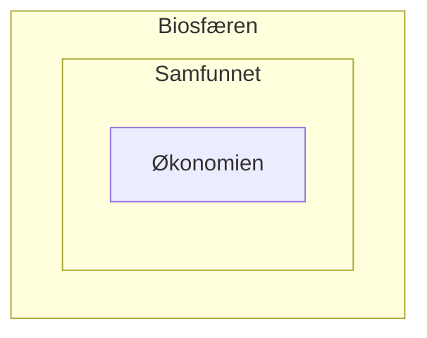

# Carson & Skauge: Bærekraftige virksomheter

[PDF](pdf/Carson_og_Skauge.pdf) · *Etikk for beslutningstakere* (2020), kap. 6, s. 126–142 · F10

**Kort fortalt:** Bærekraft handler om langsiktig ansvar og om å balansere **økonomi, sosiale forhold og miljø**. Kapitlet går fra Brundtland til FNs bærekraftsmål, spør om bærekraftig vekst er mulig (svak vs. sterk bærekraft, planetens tålegrenser), og ser på hvordan bedrifter kan styres og rapportere etter **den triple bunnlinjen**.

## Bakgrunn: fra Den tause våren til bærekraftsmålene

| År | Hendelse |
|---|---|
| 1962 | Rachel Carson, *Den tause våren*: skadevirkninger av sprøytemidler. Starten på miljøbevegelsen. |
| 1972 | FNs første miljøkonferanse i Stockholm. Industrilandene ser skadene, utviklingslandene vil ikke bremses. Samme år: *Limits to Growth* (blant andre Jørgen Randers). |
| 1987 | **Brundtlandkommisjonen**, *Vår felles framtid*: lanserer begrepet **bærekraftig utvikling** |
| 1992 | Rio-konferansen: **Agenda 21**, signert av 172 land. De rike landene har hovedansvaret. Rio-erklæringen viser til føre var-prinsippet. |
| 1998 | Fredrikstaderklæringen: lokal Agenda 21 i Norge |
| 2000–2015 | FNs åtte **tusenårsmål**, særlig mot fattigdom. Andelen i ekstrem fattigdom ble halvert. |
| 2016 | **FNs 17 bærekraftsmål** (SDG) med 169 delmål trer i kraft, skal nås innen 2030. Vedtatt i 2015 etter en svært inkluderende prosess. |

!!! quote "Brundtlands definisjon"
    Bærekraftig utvikling er en utvikling som møter dagens behov uten å ødelegge mulighetene for at kommende generasjoner skal få dekket sine behov.

## Er bærekraftig vekst mulig?

| **Svak bærekraft** | **Sterk bærekraft** |
|---|---|
| Én type kapital (miljø, sosial, økonomisk) kan **erstattes** med en annen. Det totale utfallet teller. | Ingen økonomisk eller sosial gevinst kan erstatte naturens økologiske funksjoner (som klimaregulering) |
| Hogst av regnskog kan forsvares hvis den gir store verdier og arbeidsplasser (men ikke med slavearbeid) | Aktivitet som reduserer miljøkapitalen kan ikke tillates, uansett lønnsomhet |
| Brundtland bygger på dette synet | Hvis økologien stadig «veksles inn», blir resultatet katastrofalt også for økonomi og samfunn |

### Gore mot Yunus

- **Muhammad Yunus** (fredspris 2006, mikrokreditt) vil bekjempe fattigdom med fortsatt vekst og «sosial forretningsvirksomhet». 40 % av verdens befolkning har 94 % av inntektene.
- **Al Gore og FNs klimapanel** (fredspris 2007) mener global vekst må bremses kraftig for å stanse klimaendringene.
- Spørsmålet ingen stilte på konferansen i Oslo i 2007: **Er målene forenlige?** Fattigdomsbekjempelse ser ut til å kreve vekst, klimakampen ser ut til å kreve mindre vekst. Konflikten er ikke bare mellom «harde» økonomiske og «myke» verdier; sosiale og økologiske verdier kan også stå mot hverandre. Samtidig rammes de fattigste (som Bangladesh) hardest av klimaendringene.

### Føre var-prinsippet

Hvis en handling kan gi **alvorlig eller irreversibel skade** og det ikke finnes vitenskapelig enighet om at skaden ikke vil skje, ligger **bevisbyrden** på dem som vil gjennomføre handlingen. Se [Hovi](hovi.md) for en kritisk drøfting.

### Økologisk økonomi og planetens tålegrenser

Brundtland og tusenårsmålene behandlet de tre søylene som likeverdige og uavhengige. **Økologisk økonomi** sier at økonomien er et undersystem av samfunnet, som igjen er et undersystem av **biosfæren** («bløtkakemodellen»):

- **Planetary boundaries** (Johan Rockström mfl., 2009): ni globale prosesser som definerer et trygt handlingsrom for menneskeheten. Ved oppdateringen i 2015 var **fire grenser overskredet**: klima, tap av biologisk mangfold, endret arealbruk og nitrogen- og fosforstrømmer.
- Tålegrensene var med i første utkast til bærekraftsmålene, men ble tatt ut fordi lavinntektsland fryktet at de kunne brukes til å hindre fattigdomsbekjempelse.

## Bærekraftige virksomheter

- Virksomheter velger ofte ut noen bærekraftsmål de vil bidra til. **Problemet:** å fremme ett mål kan svekke et annet, og det snakker virksomhetene sjelden om.
    - Fiskeoppdrett: bidrar til mål 2 (sult), kan svekke mål 14 (livet under vann).
    - Vindkraft: bidrar til mål 7 (ren energi), kan svekke mål 15 (livet på land).
- **WBCSD** (Næringslivets verdensråd for bærekraftig utvikling): over 200 selskaper. *Vision 2050* (2010): 9 milliarder mennesker skal leve godt innenfor planetens grenser. Hovedpoeng: bedriftene må selv bære kostnadene de påfører samfunnet. Fulgt opp av *Action 2020*.
- **Mål 17** (samarbeid for å nå målene) forplikter næringslivet direkte. Noen mener likevel at bedrifter bør konsentrere seg om lønnsomhet og overlate bærekraft til myndighetene.

## Den triple bunnlinjen

**John Elkington**, *Cannibals with Forks* (1998): Er det framskritt når en kannibal bruker kniv og gaffel? Store selskaper sluker konkurrentene, men Elkington mener de kan «siviliseres». En bedrift må holde seg over bunnlinjen på tre områder:

| Bunnlinje | Kapital | Innhold |
|---|---|---|
| **Sosial** (people) | Sosial kapital: nettverk, tillit, godvilje, lojalitet | Internt: arbeidsforhold, diskriminering. Eksternt: menneskerettigheter, korrupsjon, lokalsamfunn. Henger sammen med interessentledelse. |
| **Miljømessig** (planet) | Miljøkapital/naturkapital: ressurser, mulighet til å deponere avfall, naturlige prosesser | Avfall, råvarer, grønn produksjon og transport, økologisk fotavtrykk. Ofte lønnsomt på sikt (energisparing). |
| **Økonomisk** (profit) | Økonomisk kapital: tomter, bygninger, maskiner, varer, finanser | Ikke bare egen lønnsomhet, men virksomhetens økonomiske virkning på samfunnet. Overskudd er et **middel** til sosiale og miljømessige goder, ikke et mål. |

### Tilfellet Shell

- 1995: Greenpeace stoppet senkingen av plattformen **Brent Spar**, og ni ledere i Ogoni-bevegelsen (MOSOP), blant dem **Ken Saro-Wiwa**, ble henrettet av Nigerias militærregime. Mange mente Shell burde brukt innflytelsen sin.
- Fra 1999 publiserte Shell rapporten *People, planet, profit*. Likevel er kjernevirksomheten fortsatt oljeutvinning i områder med miljøødeleggelse og undertrykking. En FN-rapport (2011) slo fast at Shell hadde forsømt oljesøl i Nigerdeltaet.
- Det er ofte virksomhetene som får mest kritikk som rapporterer mest. Derfor anklages bærekraftsrapportering for **grønnvasking**. Motargumentet er at **«bordet fanger»**: rapporteringen forplikter, og omgivelsene kan holde virksomhetene ansvarlige.

### Måling og rapportering

| Område | Status |
|---|---|
| Økonomisk | Lovpålagt årsrapport med revisjon. Bærekraft krever en bredere forståelse enn regnskapet. |
| Miljø | «Grønne regnskap». I Norge lovpålagt fra 1998, men uten revisjonskrav. Frivillige standarder: **ISO 14001** og **Miljøfyrtårn**. |
| Sosialt | Vanskeligst å måle. **ISO 26000** (2010) er en veileder, ikke en sertifisering. Større norske selskaper er pålagt å rapportere om samfunnsansvar fra 2013. |
| Samlet | **Global Reporting Initiative (GRI)**: en guide til hva som skal måles og hvilke indikatorer som gjør det mulig å sammenligne med andre og med tidligere år |

### Kritikk av metaforen

- **Simon Zadek:** De tre områdene henger så tett sammen at det ikke alltid gir mening å dele dem. De kan heller tegnes som sirkler inni hverandre.
- Bunnlinjemetaforen antyder at alle tre er like viktige. Tre alternative syn:
    1. **Antroposentrisk:** det sosiale er overordnet; alt handler til slutt om menneskers interesser.
    2. **Økonomisk forrang:** bedrifter skal bare fremme de sosiale og miljømessige verdiene som øker overskuddet.
    3. **Økologisk forrang:** økonomi og samfunn er helt avhengige av en fungerende biosfære.

## Repetisjonsspørsmål

1. Hva er Brundtlandkommisjonens definisjon av bærekraftig utvikling?

    ??? success "Fasit"
        En utvikling som møter dagens behov uten å ødelegge mulighetene for at kommende generasjoner skal få dekket sine behov. Den forener respekt for naturens bærekraft med sikring av menneskelige verdier.

2. Hva er forskjellen på svak og sterk bærekraft?

    ??? success "Fasit"
        Svak bærekraft tillater at én type kapital erstattes med en annen, så miljøskade kan forsvares hvis den gir store økonomiske eller sosiale gevinster. Sterk bærekraft sier at ingen gevinst kan erstatte naturens økologiske funksjoner, så aktivitet som reduserer miljøkapitalen ikke kan tillates uansett lønnsomhet.

3. Drøft om bærekraftig vekst er mulig. (Studiespørsmål a)

    ??? success "Fasit"
        Brundtland mente vekst og miljøhensyn kan balanseres (svak bærekraft). Gore/Yunus-konflikten viser spenningen: fattigdomsbekjempelse ser ut til å kreve vekst, mens klimakampen ser ut til å kreve mindre vekst. Økologisk økonomi og *Limits to Growth* utfordrer vekstidealet, og planetens tålegrenser viser at fire grenser allerede er overskredet. Et godt svar drøfter begge sider og konkluderer selv, for eksempel med at vekst kan være mulig i fattige land hvis de rike tar de største kuttene.

4. Er det innebygde dilemmaer i FNs bærekraftsmål? (Studiespørsmål b)

    ??? success "Fasit"
        Ja. Å oppnå ett mål kan svekke et annet: fiskeoppdrett (mål 2 mot mål 14), vindkraft (mål 7 mot mål 15). På et overordnet nivå står fattigdomsbekjempelse og vekst mot klima og miljø. Det at planetens tålegrenser ble tatt ut av målene fordi fattige land fryktet de ville hindre utvikling, viser at konflikten er reell.

5. Hva er føre var-prinsippet? (Studiespørsmål c)

    ??? success "Fasit"
        Hvis en handling eller politikk kan gi alvorlig eller irreversibel skade, og det ikke finnes vitenskapelig enighet om at skaden ikke vil skje, ligger bevisbyrden på dem som vil gjennomføre den. De som vil slippe ut miljøgifter eller hogge skog må bevise at det ikke gir uopprettelig skade.

6. Hva er planetens tålegrenser, og hvilke er overskredet?

    ??? success "Fasit"
        Et rammeverk av Rockström mfl. (2009) med ni globale prosesser som definerer et trygt handlingsrom for menneskeheten. I 2015 var fire overskredet: klima, tap av biologisk mangfold, endret arealbruk og nitrogen- og fosforstrømmer.

7. Hva er den triple bunnlinjen, og hvem lanserte begrepet?

    ??? success "Fasit"
        John Elkington (*Cannibals with Forks*, 1998). En bedrift må holde seg over bunnlinjen på tre områder: sosialt (people), miljømessig (planet) og økonomisk (profit). Suksess måles ikke bare i egen økonomi, men også i virkning på miljø og samfunn.

8. Hva lærer Shell-tilfellet oss om bærekraftsrapportering?

    ??? success "Fasit"
        Shell begynte å rapportere etter den triple bunnlinjen etter krisene i 1995 (Brent Spar og henrettelsene i Nigeria), men kjernevirksomheten er fortsatt olje i områder med miljøskade og undertrykking. Det er ofte de mest kritiserte virksomhetene som rapporterer mest, så rapportering kan være grønnvasking. På den andre siden forplikter rapporteringen («bordet fanger»).

9. Hvilke svakheter har metaforen om den triple bunnlinjen?

    ??? success "Fasit"
        Zadek påpeker at de tre områdene henger så tett sammen at de ikke kan skilles som tre linjer. Metaforen antyder også at de er like viktige, mens man kan hevde at det sosiale er overordnet (antroposentrisk), at økonomien er overordnet i næringslivet, eller at økologien har forrang fordi alt avhenger av biosfæren.
