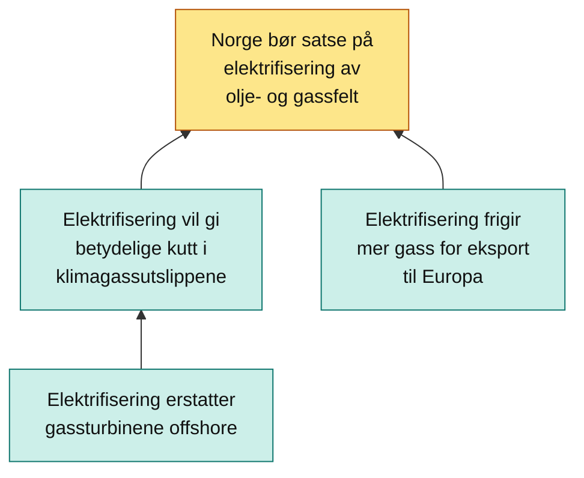
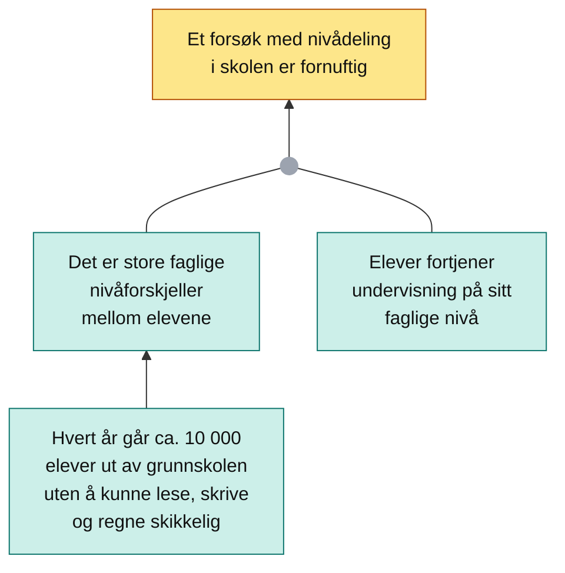
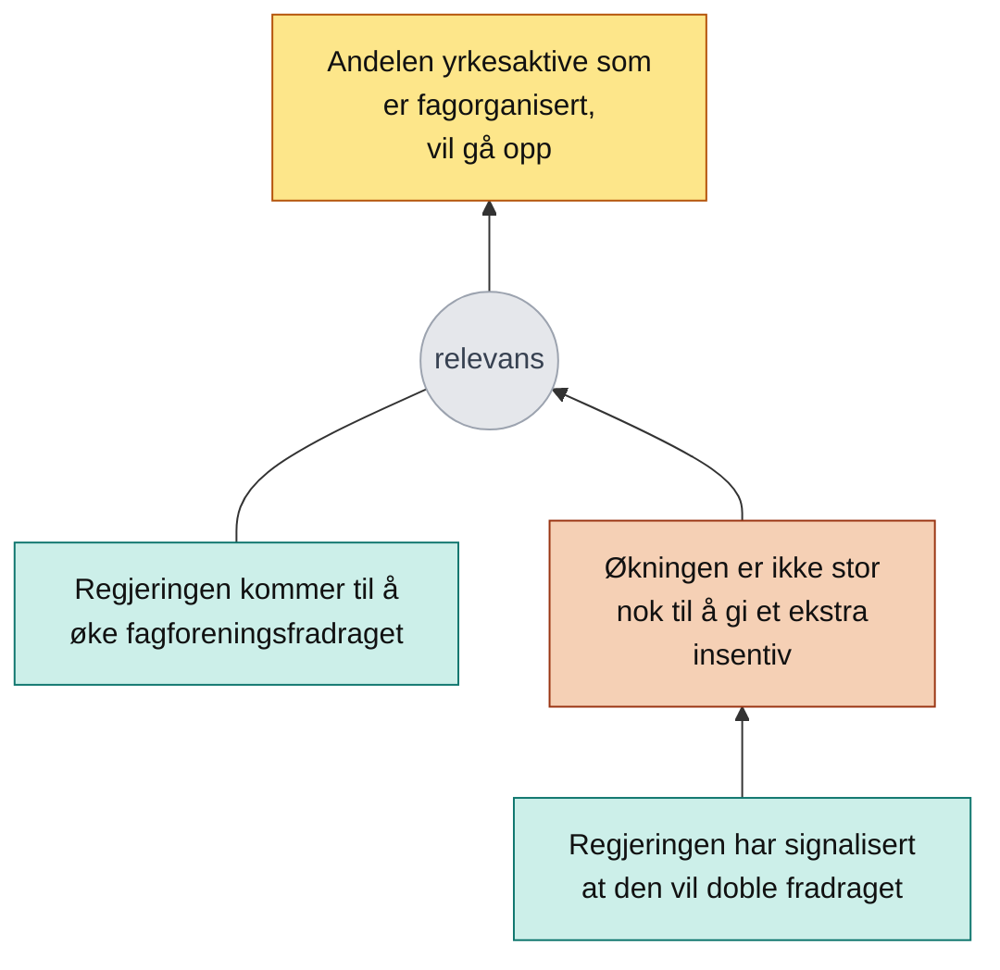
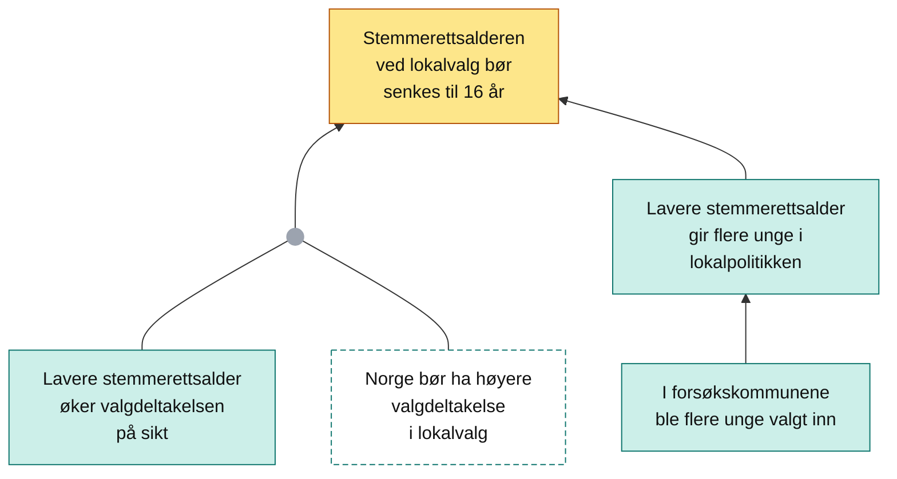

# Tenk! del 1: Argumentasjonsteori

[PDF](pdf/Tenk.pdf) · *Tenk!* kap. 1–3 (Antonsen og Hjortland) · F1–F2

**Kort fortalt:** Argumentasjon er en ferdighet du kan øve på. Del 1 gir deg tre verktøy:

1. **Kapittel 1 (debatt):** hvorfor vi har offentlig debatt, hvilke spilleregler debatten bør følge, og hvordan du kjenner igjen de to vanligste formene for usaklighet: personargumenter og stråmenn.
2. **Kapittel 2 (analyse):** hvordan du finner ut hva noen egentlig argumenterer for, hvilke grunner de gir, og hvordan grunnene henger sammen. Resultatet tegnes som et argumentasjonsdiagram.
3. **Kapittel 3 (vurdering):** hvordan du avgjør om argumentene holder: er de *riktige*, og hvor *relevante* er de?

Rekkefølgen er viktig: du må **analysere** før du kan **vurdere**. Eksemplene på denne siden er hentet fra boka og gjenfortalt med egne ord, så du kjenner dem igjen når du leser kapitlene.

!!! info "Hvordan diagrammene leses"
    Standpunktet står **øverst** (gult). Argumenter (grønne) peker oppover mot påstanden de støtter. Motargumenter er brune. Når flere påstander møtes i en liten grå prikk før pilen, utgjør de **ett sammensatt argument**: de gir én grunn sammen, ikke hver for seg. Stiplet kant betyr at påstanden er implisitt.

## Kapittel 1: Argumentasjon og debatt

### Offentlig debatt

Offentlig debatt er debatt som i prinsippet er tilgjengelig for alle. Boka nevner alt fra partilederdebatter på NRK og debattinnlegg i avisene til kommentarfelt, Facebook-grupper og en «NEI TIL EU»-graffiti. Å like et innlegg om dyrevern eller bruke et «Black Lives Matter»-profilbilde er også ytringer i offentligheten. Vi deltar altså oftere enn vi tror.

- **Samfunnsdebatt** handler om samfunnsspørsmål, som lover, prioriteringer og moralske spørsmål. Den er avgjørende for velinformerte demokratiske beslutninger.
- **Akademisk debatt** foregår blant forskere i tidsskrifter, på konferanser og i rapporter. Det som skiller den fra annen debatt, er ikke temaet, men at kravene til argumentasjon, evidens og begrunnelse er strengere. Man forventes å svare på innvendinger og trekke tilbake påstander som er tilbakevist.

### Hvorfor har vi offentlig debatt?

| Formål | Hvem | Kjernen |
|---|---|---|
| **Søken etter kunnskap** | John Stuart Mill | Debatt er et *samarbeid* om å forbedre oppfatningene våre. En oppfatning som bare er en antakelse og aldri er utfordret, er en form for overtro. Når andre er uenige med oss, blir vi tvunget til å gi grunner og kan vurdere oppfatningene grundigere. |
| **Demokratisk legitimitet** | Jürgen Habermas | Politiske beslutninger gir regler alle må leve etter, også de som er uenige. De er bare legitime hvis de bygger på en debatt som er (1) åpen for alle, med deltakere som behandles som likeverdige, og (2) preget av rasjonell og saklig argumentasjon. Det holder ikke å nå konsensus hvis beslutningen ikke også er rasjonelt begrunnet. |

Mills bilde er en idealisering: ikke alle debattanter bryr seg om kunnskap eller vil samarbeide. Men boka peker på at tanken om et felles mål ikke er fremmed. Forskere drar på konferanser for å finne svar sammen, studenter diskuterer for å lære av hverandre, og selv politikere som vil vinne velgere, debatterer også for å finne de beste løsningene.

### Debattnormene

Hvis debatten skal gi kunnskap, trenger den spilleregler:

| Norm | Hva den krever |
|---|---|
| **1. Vær forberedt på å gi grunner for oppfatningene dine** | Du må kunne forklare *hvorfor* du mener det du mener. Den som tviholder på et standpunkt og nekter å begrunne det, stopper debatten. |
| **2. Forsøk å bidra med riktig informasjon** | Ikke bare si det du tror stemmer, men sjekk evidensen. Vær upartisk, vær åpen for at du kan ta feil, og trekk tilbake påstander som ikke holder. |
| **3. Forsøk å bidra med relevant informasjon** | Det du sier, må ha betydning for spørsmålet som diskuteres. |

Legg merke til ordet **forsøk**. Normene krever en ærlig innsats. Det er fullt mulig å si noe som tilfeldigvis er sant, uten å ha fulgt norm 2, hvis du ikke brydde deg om å sjekke det.

#### Løgn og bullshit (Frankfurt)

Filosofen Harry Frankfurt mener en av de største utfordringene for offentlig debatt er at folk farer med **bullshit**:

- **Den som lyver**, sier bevisst noe han ikke tror er riktig. Løgneren *utnytter* at publikum forventer at han prøver å si noe sant.
- **Den som farer med bullshit**, er likegyldig til om det han sier, er riktig eller relevant. Han sier det som tjener saken, enten det er å selge et produkt eller vinne velgere.

Ifølge Frankfurt er bullshit en **større trussel** enn løgn. Løgn virker bare fordi vi fortsatt forventer sannhet. Bullshit undergraver selve normene: hvis vi venner oss til at debattanter sier hva som helst, mister debattnormene status som felles regler.

### To vanlige brudd på debattnormene

Når vi kritiserer noen for å være usaklige, handler det ikke bare om at de har sagt noe feil, men om at de ikke deltar i debatten som et samarbeid.

#### Personargumentasjon

Et **personargument** skal redusere troverdigheten til en person eller gruppe ved å beskrive dem negativt. Vi diskuterer person i stedet for sak. Strategien er enkel: får publikum et dårlig inntrykk av personen, blir de mindre lydhøre for argumentene, *uansett om argumentene er gode eller dårlige*.

!!! example "Eksempel fra boka: vinsalg i butikk"
    I en debatt om alkoholpolitikk argumenterer du for vinsalg i dagligvarebutikker: Danmark har innført det med hell, og flertallet av nordmenn ønsker det.

    Motparten svarer med å minne om at du i fjor måtte beklage en episode på et nachspiel etter fylkesårsmøtet, og spør om du da virkelig skal mene noe om vin i butikk.

    **Analyse:**

    1. *Er motpartens påstand riktig?* Anta at den er det: episoden skjedde, og den skyldtes uvettig drikking.
    2. *Er den relevant?* Gitt at den er riktig, gjør den det mindre sannsynlig at vi bør ha vinsalg i butikk? Nei. Dine drikkevaner sier ingenting om hva Danmark har gjort eller hva flertallet av nordmenn ønsker. Om argumentene dine holder, kan undersøkes helt uavhengig av din troverdighet.
    3. *Hvilke normer brytes?* Norm 3 (relevans): påstanden er riktig, men irrelevant. Norm 1 (gi grunner): motparten fikk sjansen til å forklare hvorfor vi *ikke* bør ha vin i butikk, men angrep deg i stedet.

    Poenget er at **et personargument kan være riktig og likevel usaklig.** Det avgjørende er relevans.

!!! example "Eksempel fra boka: formuesskatt og misunnelse"
    I 2018 kritiserte SV-leder Audun Lysbakken Solberg-regjeringen for at de med størst formue fikk en stor andel av skattekuttene, penger som kunne gått til bedre tjenester. Finansminister Siv Jensen svarte med innlegget «Er Lysbakken verdensmester i misunnelse?», der hun skrev at misunnelse ikke bør være utgangspunktet for skattepolitikken.

    **Analyse:** Jensen prøver å **mistenkeliggjøre motivene** til Lysbakken og dermed svekke troverdigheten hans. Men om Lysbakken er misunnelig, er irrelevant både for argumentasjonen hans og for spørsmålet om de rikeste bør betale mer skatt. Det blir ikke mer eller mindre riktig å øke skatten avhengig av Lysbakkens psykologi. Det er et usaklig personargument.

**Slik kjenner du igjen usaklig personargumentasjon:**

- Se etter personkarakteristikker og anklager.
- Sjekk om taleren prøver å redusere motpartens troverdighet.
- Sjekk om de personlige egenskapene er relevante for det som diskuteres.

!!! tip "Når er personargumenter saklige?"
    Personargumenter er ikke alltid usaklige. Boka nevner to tilfeller:

    - **Standpunktet handler om personen.** I en debatt om «Jonas Gahr Støre er ikke egnet som statsminister» eller «Justisministeren bør ikke ha Stortingets tillit» er det naturlig å argumentere med påstander om personen, for eksempel «Justisministeren løy om bruken av svart arbeidskraft». Argumentene må fortsatt være riktige og relevante.
    - **Vi vurderer om en kilde er pålitelig.** Påstanden «Det er usannsynlig med renteøkning før neste år» er mer troverdig fra en samfunnsøkonom enn fra en tilfeldig nabo.

#### Stråmannsargumentasjon

En **stråmann** er en gjengivelse av motpartens syn som gjør det mindre rimelig eller mer kontroversielt enn det egentlig er. **Stråmannsargumentasjon** er å argumentere mot stråmannen i stedet for mot det motparten faktisk mener.

!!! example "Eksempel fra boka: cannabis"
    Du argumenterer for at **privat bruk av cannabis** bør legaliseres, fordi det har relativt få skadevirkninger og vil ramme organisert kriminalitet.

    Motdebattanten sier at han, «i motsetning til» deg, mener at **fri flyt av narkotika** er en dårlig idé, fordi det fører til personlige tragedier, overdoser og gjengkriminalitet.

    **Analyse:**

    1. *Er ditt syn gjengitt rimelig?* Nei. Du sa ingenting om fri flyt eller om narkotika generelt, bare om privat bruk av cannabis.
    2. *Er uenigheten reell?* Nei, han skaper en **skinnuenighet**. Den reelle uenigheten handler om privat bruk av cannabis.
    3. *Treffer argumentene?* Argumentene hans er argumenter mot fri flyt av narkotika. Ingen av dem sier noe om hvorvidt privat bruk av cannabis bør legaliseres.
    4. *Normer:* Han bryter norm 2 (feilinformerer publikum om hva du mener), norm 3 (argumentene er bare relevante for stråmannen) og norm 1 (ingenting han sier, er en grunn for eller mot det som faktisk diskuteres).

!!! example "Eksempel fra boka: «terroristen vant»"
    I debatten etter 22. juli om hvordan nytt regjeringskvartal skulle finansieres, ville statsminister Erna Solberg finansiere det «under strek», altså utenfor det vanlige statsbudsjettet. Kritikerne mente at det ville omgå handlingsregelen for oljepengebruk, og at prosjektet burde finansieres på vanlig måte.

    Solberg svarte kritikerne med at man kunne la være å bygge, og dermed si at terroristen vant, med de skadde bygningene stående som et monument over terroren. Hun beklaget senere uttalelsen.

    **Analyse:**

    - **Stråmannen:** Solberg gir inntrykk av at kritikerne er imot å bygge nytt regjeringskvartal. Men de var bare imot *finansieringsmåten*.
    - **Argumentene treffer ikke:** at bygningene blir stående og at «terroristen vant», er i beste fall konsekvenser av *ikke å bygge*. De er motargumenter mot stråmannsstandpunktet, ikke mot kritikernes egentlige syn. For at de skulle vært relevante, måtte Solberg også vist at uten finansiering «under strek» blir det ikke bygd i det hele tatt, og det hadde hun ikke argumentert for.
    - **I tillegg** knytter hun kritikerne urettmessig til 22. juli-terroristen.

**Slik kjenner du igjen stråmannsargumentasjon:**

- Sjekk om taleren har gjengitt motpartens syn på en rimelig måte.
- Sjekk om taleren uttrykker en reell og relevant uenighet.
- Sjekk om debatten avspores når motpartens synspunkt formuleres.

### Logikk og retorikk

Argumenter har to ulike funksjoner:

| | Retorisk funksjon | Logisk funksjon |
|---|---|---|
| **Hva** | Å **overbevise** tilhørere | Å **støtte** (eller svekke) en påstand, altså gi grunn til å tro den |
| **Studeres i** | Retorikk: hvilke argumenter overbeviser, og hvorfor? | Logikk: hvilke argumenter gir faktisk grunn til å tro en påstand? |
| **Hva påvirker** | Hvem som taler, makt, sympati og hva publikum *ønsker* å tro | Bare om argumentet er riktig og relevant |

Det er ikke galt i seg selv å tilpasse argumentene til publikum: en politiker kan argumentere på én måte på landsmøtet og en annen på NRK. Men boka viser hvordan et argument kan overbevise uten at vi *burde* blitt overbevist:

- **Hvem som taler:** argumenterer bestevennen din for veganisme, er du mer lydhør enn hvis det samme står i et anonymt kommentarfelt. En innvending fra sjefen kan virke tyngre enn den er.
- **Motivert resonnering:** vi lar oss lettere overbevise av det vi ønsker er sant. Den som skal arve en formue, synes argumenter mot arveavgift er rimeligere enn de er. Studenter er mer mottakelige for argumenter for økt studielån, pensjonister for økt pensjon.
- **Pynt og sympati:** en forsvarsadvokat kan vise til at ingen har sett «denne hardtarbeidende tobarnsfaren» på åstedet, og en politiker kan si at skatteøkninger rammer «vanlige folk».

Når vi derimot prøver å finne ut hva som er riktig, slik en lege som stiller en diagnose eller en forsker som vil utelukke en hypotese, er det den logiske funksjonen vi bruker. **Resten av del 1 handler om den logiske funksjonen.**

### Riktighet og relevans

- Et argument er **riktig** hvis påstanden(e) det består av, er riktige.
- Et argument er **relevant** i den grad det taler for (eller mot) påstanden det er rettet mot, *gitt at det er riktig*.
- Hvor mye støtte argumentet gir, avhenger av **begge**.

!!! example "Eksempel fra boka: kaffe og kreft"
    I en helsepodkast påstår en deltaker at kaffedrikking øker risikoen for kreft, og gir to argumenter:

    | Argument | Riktig? | Relevant? | Støtte? |
    |---|---|---|---|
    | «Koffein er kreftfremkallende.» | Nei, så langt forskningen vet | Ja: *hvis* det stemte, ville det gjort standpunktet mye mer sannsynlig, siden kaffe inneholder mye koffein | Nei |
    | «De fleste som dør av kreft i Norge, er kaffedrikkere.» | Trolig ja, siden flertallet av voksne drikker kaffe daglig | Nei: de fleste som dør av kreft, har også spist frokost og brukt sko. At mange kreftsyke drikker kaffe, viser ikke at kaffen er årsaken | Nei |

    Begge argumentene mislykkes, men av ulike grunner. Det første fordi det er feil, det andre fordi det er irrelevant.

Relevans har **grader**. Tenk på det slik: *hvor mye mer sannsynlig blir standpunktet hvis argumentet er sant?* «Koffein er kreftfremkallende» er svært relevant, fordi standpunktet da ville blitt klart mer sannsynlig.

## Kapittel 2: Argumentasjonsanalyse

Å **analysere** argumentasjon betyr å bryte den ned i bestanddeler og kartlegge **argumentasjonsstrukturen**: sammenhengen mellom argumentene innbyrdes og mellom argumentene og standpunktet. Analysen avdekker strukturen; diagrammet illustrerer den.

| Begrep | Definisjon |
|---|---|
| **Påstand** | Noe som kan være riktig eller uriktig, uttrykt med en fortellende (deklarativ) setning, for eksempel «Kronekursen er synkende» |
| **Argument** | Én eller flere påstander som er ment å støtte eller svekke en annen påstand |
| **Standpunkt** | Hovedpåstanden det argumenteres for eller mot |
| **Standpunktargument** | Argument som støtter standpunktet direkte |
| **Indirekte argument** | Argument som støtter (eller svekker) standpunktet ved å støtte (eller svekke) en annen påstand. Gir en **argumentasjonskjede** |
| **Sammensatt argument** | To eller flere påstander som bare *sammen* gir én grunn |
| **Implisitt påstand** | En påstand som inngår i argumentet, men ikke er uttrykt |
| **Motargument** | Argument som er ment å svekke en påstand |

### Finne standpunktet

Standpunktet er hovedpåstanden, typisk noe det er uenighet om. Noen ganger er det lett å finne, andre ganger må du rekonstruere det.

!!! example "Eksempel fra boka: studentrabatt"
    Et VG-innlegg har overskriften «Studentrabatten må endres». Overskriften sier ikke *hvilken* rabatt eller *hvordan* den skal endres. Leser vi teksten, ser vi at det gjelder rabatten på kollektivtransport, som i dag bare gjelder studenter under 30, og at forfatteren vil at den skal gjelde alle studenter.

    Et dekkende standpunkt er derfor: **«Studentrabatten på kollektivtransport bør gjelde for alle studenter, uansett alder.»** Det er en omformulering, ikke en ordrett setning fra teksten. Brukte vi bare overskriften, ville analysen fått med mindre av hva forfatteren faktisk mener.

!!! example "Eksempel fra boka: mobilbruk"
    I et innlegg skriver Nikolai Astrup (H) om unges mobilbruk: elever som bruker mobilen over seks timer om dagen, og sosiale medier som gir psykiske plager, utestengelse, digital mobbing og svekket konsentrasjon. Han skriver at han er liberal, men at barns selvregulering ikke fungerer og at foreldre ikke klarer å enes, så tiden er kommet for å snakke om reguleringer.

    Standpunktet står ingen steder. Men siden han lister opp negative følger av mobilbruk blant unge, og konkluderer med regulering, er et rimelig standpunkt: **«Unges mobilbruk og bruk av sosiale medier bør begrenses gjennom regulering.»** Poenget er at foreldre ikke er nok; det trengs regler, for eksempel i lov eller forskrift.

**Tips for å finne standpunktet:**

- Standpunktet er hovedpåstanden det argumenteres for eller mot, selv om argumentene ikke nødvendigvis er gode.
- Det er typisk noe det er uenighet om eller som er uavklart.
- Kunnskap om debattkonteksten, temaet og deltakerne hjelper.
- Ofte finnes ingen enkelt setning som dekker standpunktet. Da må du omformulere selv.
- Formuler det som **én fortellende påstand**.
- Ikke forveksle det med overskrifter og ingresser; de er ofte skrevet av redaksjonen.
- **Tolkningen må ha dekning i teksten.** Ellers forvrenger du synspunktet og lager i verste fall en stråmann.

### Finne argumentene

Let etter resonnementer, statistikk, rapporter og forskning. Signalord som «derfor», «fordi», «hvis», «ettersom», «siden», «følgelig» og «dersom» viser sammenhenger, men:

- **Rekkefølgen er ikke strukturen.** «Elektrifisering vil gi betydelige kutt i klimagassutslippene. Derfor bør Norge satse på elektrifisering av olje- og gassfelt» har samme struktur som «Norge bør satse på elektrifisering, for det vil gi betydelige kutt i utslippene».
- **Signalordene kan mangle.** «Elektrifisering vil gi betydelige kutt. Norge bør satse på elektrifisering» forstår de fleste likevel som argumentasjon.
- **Én setning kan inneholde både argument og standpunkt.** «Siden ulykkesrisikoen øker betydelig med høyere hastigheter, bør Norge ikke tillate fartsgrenser over 110 km/t» må deles i to bokser i diagrammet.
- **Selv dårlige argumenter er argumenter.** At du identifiserer noe som et argument, betyr ikke at du godtar det. Vurderingen kommer senere.

### Standpunktargumenter og indirekte argumenter

Boka bygger opp et eksempel om elektrifisering av olje- og gassfelt steg for steg:

- **Ett standpunktargument:** «Elektrifisering vil gi betydelige kutt i klimagassutslippene» støtter «Norge bør satse på elektrifisering av olje- og gassfelt».
- **To uavhengige standpunktargumenter:** debattanten legger til at elektrifisering vil frigi mer gass for eksport til Europa. De to er uavhengige grunner og får hver sin pil.
- **Et indirekte argument:** bedt om å begrunne utslippskuttet, sier debattanten at elektrifisering erstatter gassturbinene på plattformene. Det støtter standpunktargumentet, ikke standpunktet direkte, og gir en **argumentasjonskjede**.



Den som er *imot* elektrifisering, kan bygge en kjede på samme måte: «Norge bør ikke satse på elektrifisering, fordi det vil gi høyere strømpriser for vanlige husholdninger, og NVE anslår at elektrifiseringstiltak vil gi høyere strømpriser.» Henvisningen til NVE er et indirekte argument for strømprisargumentet. Det kan selv angripes: er det faktisk NVEs anslag (riktighet), og sier beregningene noe om de reelle kostnadene (relevans)?

### Deskriptiv og normativ argumentasjon

| | Deskriptiv påstand | Normativ påstand |
|---|---|---|
| **Hva** | Beskriver hva som er tilfelle | Vurderer noe: moralsk, estetisk eller hva vi bør gjøre |
| **Eksempler fra boka** | «Kaffedrikking øker risikoen for kreft.» «Andelen yrkesaktive som er fagorganisert, vil gå opp.» | «Norge bør satse på elektrifisering av olje- og gassfelt.» «Privat bruk av cannabis bør legaliseres.» |

Skillet er **ikke** det samme som «er» og «bør»:

- «Charles Dickens er en god forfatter» er normativ (en estetisk vurdering), men sier ikke noe om hva vi bør gjøre.
- «Eiendomsskatt er urettferdig» og «Russens pengebruk er uforsvarlig» er normative, selv om de bruker «er».
- «Ingen skal forfølges på grunn av sin tro» og «Gutter gråter ikke» er normative uten verken «er» eller «bør».
- «Oljeprisen bør falle når produksjonen avtar neste år» kan være deskriptiv: en prognose om hva som sannsynligvis vil skje.

Spør deg selv: *beskriver setningen hvordan verden er, eller vurderer den noe?*

**Normative argumenter** kan være generelle normer og rettigheter («Det er galt å stjele», «Barn har rett til en trygg oppvekst») eller konkrete vurderinger («Drivstoffavgiftene er for høye», «Bybanen blir for dyr»).

!!! warning "Den skjulte vurderingen i konsekvensargumenter"
    I normativ argumentasjon er det vanlig å vise til konsekvenser. «Norge bør satse på elektrifisering, fordi det vil gi betydelige kutt i klimagassutslippene» kan se ut som om et normativt standpunkt hviler på bare en deskriptiv påstand. Men argumentet forutsetter en stilltiende vurdering: **at det er bra å kutte klimagassutslipp.** Uten den ville argumentet ikke vært relevant. Slike **konsekvensargumenter** er derfor nesten alltid sammensatte av en deskriptiv påstand og en normativ vurdering, og analysen må få fram vurderingen.

### Sammensatte argumenter

Noen påstander gir hver sin grunn; andre gir bare én grunn sammen. Bokas klassiske eksempel:

> «Alle mennesker er dødelige. Sokrates er et menneske. Derfor er Sokrates dødelig.»

«Alle mennesker er dødelige» og «Sokrates er et menneske» gir ikke to grunner til at Sokrates er dødelig. De gir **én grunn sammen**. I diagrammet samles pilene.

!!! example "Eksempel fra boka: studiestøtte og frafall"
    «Færre studenter vil fullføre utdanningen sin i årene som kommer. Ikke bare går søkertallene ned. Høstens statsbudsjett øker ikke studiestøtten, og uten høyere studiestøtte vil frafallet øke.»

    **Testen for sammensatte argumenter** er et tankeeksperiment: tenk deg at den ene påstanden er usann, og se om den andre mister relevansen.

    - Hvis statsbudsjettet faktisk *øker* studiestøtten, er «uten høyere studiestøtte vil frafallet øke» ikke lenger relevant.
    - Hvis lavere studiestøtte uansett *ikke* påvirker frafallet, er det uklart hvorfor «statsbudsjettet øker ikke studiestøtten» skal støtte standpunktet.

    De to påstandene henger altså sammen og utgjør ett sammensatt argument. «Søkertallene går ned» er derimot uavhengig: vi kan avvise den uten at det påvirker relevansen til studiestøtteargumentet, og omvendt.

    ```mermaid
    flowchart BT
        S["Færre studenter vil<br>fullføre utdanningen<br>i årene som kommer"]:::sp
        A1["Søkertallene<br>går ned"]:::arg
        J((" ")):::knute
        B1["Høstens statsbudsjett<br>øker ikke studiestøtten"]:::arg
        B2["Uten høyere studiestøtte<br>vil frafallet øke"]:::arg
        A1 --> S
        B1 --- J
        B2 --- J
        J --> S
        classDef sp fill:#fde68a,stroke:#b45309,color:#111
        classDef arg fill:#ccefe9,stroke:#0f766e,color:#111
        classDef knute fill:#9ca3af,stroke:#9ca3af
    ```

Hvorfor er dette viktig? Fordi et motargument mot én del av et sammensatt argument svekker **hele** argumentet, ikke bare den ene påstanden. Den som argumenterer, sier sjelden selv at to påstander hører sammen, så det må du vurdere.

### Implisitte påstander

Vi utelater ofte påstander vi regner med at alle er enige i, eller som publikum allerede vet. Noen ganger underslår vi med vilje kontroversielle antakelser for å skjule svakheter. Analysen skal gjøre dem synlige, fordi de avgjør hvordan argumentet skal vurderes.

!!! example "Eksempel fra boka: forsvarsbudsjettet"
    «Norge bør bruke mer av statsbudsjettet på forsvar, for alle NATO-medlemmer forventes å bruke minst to prosent av BNP på forsvar.»

    Argumentet er bare relevant hvis to implisitte påstander er sanne:

    - **Norge bruker mindre enn to prosent.** Ellers er forventningen allerede oppfylt.
    - **Norge er medlem av NATO.** Ukontroversielt, men uten det ville argumentet vært langt mindre relevant, om relevant i det hele tatt.

    ```mermaid
    flowchart BT
        S["Norge bør bruke mer av<br>statsbudsjettet på forsvar"]:::sp
        J((" ")):::knute
        A["Alle NATO-medlemmer<br>forventes å bruke minst<br>2 % av BNP på forsvar"]:::arg
        I1["Norge bruker under<br>2 % av BNP på forsvar"]:::impl
        I2["Norge er medlem<br>i NATO"]:::impl
        A --- J
        I1 --- J
        I2 --- J
        J --> S
        classDef sp fill:#fde68a,stroke:#b45309,color:#111
        classDef arg fill:#ccefe9,stroke:#0f766e,color:#111
        classDef impl fill:#ffffff,stroke:#0f766e,stroke-dasharray:5 3,color:#111
        classDef knute fill:#9ca3af,stroke:#9ca3af
    ```

### Et eksempel fra start til slutt: nivådeling i skolen

Boka bruker ett innlegg gjennom hele kapittel 2. Høyre-politikerne Sandra Bruflot og Mathilde Tybring-Gjedde argumenterer i et innlegg fra 2021 for forsøk med nivådeling. De skriver blant annet at alle elever er ulike og fortjener undervisning på sitt faglige nivå, at noen henger etter med brøkregningen mens andre ligger foran, at ca. 10 000 elever hvert år går ut av grunnskolen uten å kunne lese, skrive og regne skikkelig, at rundt 90 000 elever har stort læringspotensial, og at ulike behov må møtes ulikt.

**Steg 1: Standpunktet.** Nivådeling betyr at elever deles inn i grupper etter faglig nivå. Opplæringslova forbyr faste inndelinger, men tillater det som kortvarig ordning. Forslaget er omstridt, så det er naturlig at forfatterne argumenterer. Overskriften er «Derfor er et forsøk med nivådeling i skolen fornuftig», og første setning bruker «derfor». Standpunkt: **«Et forsøk med nivådeling i skolen er fornuftig.»**

**Steg 2: Hva er *ikke* standpunktet?** Forfatterne argumenterer ikke *for* at 10 000 elever går ut uten å kunne lese skikkelig; den påstanden brukes som argument uten selv å bli begrunnet. De argumenterer heller ikke for at noen henger etter med brøk, for det er det knapt noen som er uenige i.

**Steg 3: Standpunktargumentet.** «Alle elever er ulike» tolkes som **«Det er store faglige nivåforskjeller mellom elevene.»** Forfatterne vil ikke bokstavelig vise at alle er forskjellige, men at nivåforskjellene er store. Er de ikke det, er nivådeling meningsløst.

**Steg 4: Indirekte argument.** Tallet om 10 000 elever støtter ikke nivådeling direkte. Det er et **indirekte argument** for at det er store nivåforskjeller.

**Steg 5: Sammensatt argument.** At det finnes nivåforskjeller, er ikke nok alene. For å konkludere med nivådeling må det også være en grunn til at elevene *bør* få undervisning på sitt nivå. Det sier forfatterne eksplisitt: **«Elever fortjener undervisning på sitt faglige nivå.»** Den normative påstanden og nivåforskjellene utgjør ett sammensatt argument.



**Hva analysen avslører:** forfatterne gir ingen kilde for tallet 10 000, og vi vet ikke hva det vil si å kunne lese, skrive og regne «skikkelig». Når vi går over til å vurdere argumentasjonen, er dette et svakt punkt. Det ville vært naturlig å be dem forlenge kjeden, for eksempel med resultater fra nasjonale prøver.

### Motargumentasjon

Motargumenter kan rettes mot tre ting, og analysen skal vise hvor de hører hjemme. Boka bruker eksempelet om fagforeningsfradraget: standpunktet «Andelen yrkesaktive som er fagorganisert, vil gå opp» støttes av «Regjeringen kommer til å øke fagforeningsfradraget».

| Motargumentet angriper … | Eksempel fra boka | I diagrammet |
|---|---|---|
| **… standpunktet direkte** | Et eget argument for at organisasjonsgraden *ikke* vil gå opp | Pil mot standpunktet. Alternativt kan du lage et eget diagram for negasjonen av standpunktet. |
| **… riktigheten til et argument** | «Regjeringens politiske plattform lover å holde fradraget på dagens nivå.» Da er det mindre sannsynlig at fradraget økes. | Pil mot argumentet |
| **… relevansen til et argument** | «Økningen er ikke stor nok til å gi et ekstra insentiv.» Det kan godt stemme at fradraget økes, men da betyr det ikke noe for organisasjonsgraden. | Pil mot *forbindelsen* mellom argumentet og standpunktet |

Motargumenter kan selv møtes med motargumenter. Har regjeringen signalisert at den vil **doble** fradraget, svekker det relevansinnvendingen. Det motargumentet støtter dermed indirekte standpunktet.



Motargumentene kan komme fra en annen part, men også fra den som argumenterer selv: å ta opp og avvise innvendinger kan styrke argumentasjonen.

!!! tip "Pro aut contra og pro et contra"
    - **Pro aut contra** («for *eller* mot»): argumentasjon for én side, som en forsvarsadvokat eller en politiker som forsvarer partiprogrammet. Motpartens argumenter får lite plass.
    - **Pro et contra** («for *og* mot»): hensyn på begge sider legges fram for å gi et best mulig grunnlag for å avgjøre saken, som i en utredning eller vitenskapelig studie. Det er dette du bør gjøre på eksamen.

### Språkavklaring

Når du analyserer, tolker du hva ordene betyr. To fenomener krever ekstra oppmerksomhet:

**Flertydighet.** «Å nave» kan bety å leve på trygd fra Nav, eller den gamle betydningen å topphugge trær for å høste løv. Konteksten avgjør som regel. Men i argumentet «Det er stor økonomisk ulikhet i Norge, folk med vanlig inntekt blir nedprioritert, derfor bør de rikeste betale mer skatt» er det ikke klart om «økonomisk ulikhet» betyr *inntekts*ulikhet eller *formues*ulikhet. Det gir to ulike analyser, og du må bruke konteksten for å velge den rimeligste.

**Ekvivokering** er en argumentasjonsfeil der et ord skifter betydning i argumentet.

!!! example "Eksempel fra boka: evolusjon er «bare en teori»"
    Standpunkt: «Man skal ikke stole på evolusjonsteorien.» Argument: «Evolusjonsteorien er nettopp det: en teori» og «Man skal aldri stole på en teori.»

    - Hvis «teori» betyr en **vitenskapelig begrunnet forklaring**, er første påstand riktig, men andre er feil.
    - Hvis «teori» betyr en **løs hypotese**, er andre påstand rimelig, men første er feil: evolusjonsteorien er ingen løs hypotese.

    For at begge skal virke rimelige, må ordet tolkes ulikt i de to setningene. Men da handler de om to forskjellige ting og gir ingen støtte til standpunktet.

**Fagspråk og definisjoner.** Når en jurist snakker om «påstand» eller en økonom om «depresjon», betyr ordene noe annet enn i dagligtale.

- I et innlegg om fedmeforskning brukes «fedme» i fagspråklig forstand: Folkehelseinstituttet definerer det som KMI på 30 eller mer. I analysen kan du erstatte ordet med definisjonen.
- Peter Singer skriver at hvis noen dyr også er personer, har de et særlig krav på livsbeskyttelse. Med dagligdags «person» (= menneske) er det umulig. Men Singer definerer «person» som et **rasjonelt og selvbevisst vesen**. Da blir påstanden: hvis noen dyr er rasjonelle og selvbevisste, har de et særlig krav på å få leve.

## Kapittel 3: Argumentasjonsvurdering

Formålet med å vurdere argumenter er å avgjøre om de faktisk støtter (eller svekker) påstandene de skal støtte. Du vurderer argumentene som faktisk er brukt, men egne motargumenter kan være nyttige for å avdekke svakheter.

### De fire stegene

1. **Analyser** strukturen (kapittel 2).
2. Vurder hvor **sannsynlig** det er at argumentet er **riktig**. Er det sammensatt, vurderer du hver påstand.
3. **Anta** at argumentet er riktig, og vurder hvor **relevant** det er.
4. Vurder hvor mye argumentet **støtter** påstanden, ut fra steg 2 og 3.

To utfordringer med riktighet: det finnes **ingen generell metode** (påstander kan handle om alt fra matematikk til kjøkkenredskaper), og du har sjelden direkte innsyn, så du vurderer i praksis *hvor sannsynlig* det er at påstanden stemmer.

Derfor handler argumentasjonsteori mest om **relevans**: et hypotetisk spørsmål om *forholdet* mellom argument og påstand. «La oss for argumentets skyld anta at det stemmer: gir det da grunn til å tro standpunktet?» Relevans har grader. Bokas eksempel: «Arbeidsledigheten går nedover» er relevant for «Det kommer til å gå bedre med norsk økonomi», men ikke maksimalt relevant, fordi andre forhold kan gjøre at økonomien likevel ikke blir bedre. Vi kan sjelden tallfeste relevans, men vi kan si lav eller høy, og mer eller mindre.

### To typer argumenter: deduksjon og induksjon

| | Deduksjon | Induksjon |
|---|---|---|
| **Funksjon** | Å etablere at standpunktet er en **deduktiv følge** | Å **sannsynliggjøre** standpunktet |
| **Relevans** | **Maksimal**: umulig at standpunktet er feil hvis argumentet er riktig | Mer eller mindre høy, i grader |
| **Hva avgjør** | Den **logiske formen** | Innholdet og bakgrunnskunnskap |
| **Hvor** | Matematikk, filosofi, formell logikk | Det meste av offentlig debatt |

### Deduksjon

Et standpunkt er en **deduktiv følge** av et argument hvis og bare hvis (1) det er umulig at standpunktet er feil dersom argumentet er riktig, og (2) dette beror på påstandenes **logiske form**. En slutning er **deduktivt gyldig** hvis standpunktet er en deduktiv følge av argumentet. Når du vurderer relevans, er det lurt å først sjekke om argumentet er maksimalt relevant, for det er ikke et gradsspørsmål.

!!! example "Eksempel fra boka: lakmuspapiret"
    «Denne væsken er en syre. Lakmuspapiret jeg brukte, er rødt, og rødt betyr at det er en syre.»

    Argumentet er sammensatt: «Hvis lakmuspapiret er rødt, er væsken en syre» og «Lakmuspapiret er rødt». Formen er:

    *Hvis p, så q. p. Altså q.* (**modus ponens**)

    Du kan sette inn hvilke som helst påstander for p og q, og argumentet vil fortsatt være maksimalt relevant. Det er formen, ikke innholdet, som gjør det gyldig. I dagligtale ville vi latt «hvis rødt, så syre» være implisitt; analysen gjør det eksplisitt så strukturen blir synlig.

Logisk form handler ikke bare om «hvis … så». Se også etter ord som generaliserer («alle», «ingen», «noen») og modale ord («nødvendig», «mulig», «bør», «kan»). For eksempel har «Dette objektet er F. Alle F er G. Altså er dette objektet G» en gyldig form, uansett hva F og G er.

#### Testen for deduktiv følge

1. **Anta at standpunktet er feil.**
2. **Anta at argumentet er riktig.**
3. **Sjekk om antakelsene er konsistente**: finnes det et mulig scenario der begge holder?
4. **Konkluder:** er de *inkonsistente*, følger standpunktet deduktivt. Er de *konsistente*, gjør det ikke det.

!!! example "Eksempel fra boka: testen på lakmuspapiret og homøopati"
    **Lakmus:**

    1. Anta at væsken *ikke* er en syre.
    2. Anta at lakmuspapiret er rødt, og at rødt betyr syre.
    3. Kan begge holde? Nei. Hvis papiret er rødt og rødt betyr syre, må væsken være en syre. Inkonsistent.
    4. Standpunktet følger deduktivt.

    **Homøopati:** «Homøopatisk behandling virker. For hvis den virker, vil flere som får behandlingen, oppleve bedre helse, og det gjør de.» Formen er: *Hvis p, så q. q. Altså p.*

    1. Anta at behandlingen *ikke* virker.
    2. Anta at flere får bedre helse, og at det ville skjedd hvis behandlingen virket.
    3. Kan begge holde? Ja: **placeboeffekten** kan gi bedre helse uten at behandlingen virker. Konsistent.
    4. Standpunktet følger **ikke** deduktivt.

| Navngitt form | Skjema | Gyldig? |
|---|---|---|
| **Modus ponens** | Hvis p, så q. p. Altså q. | Ja (lakmuspapiret) |
| **Modus tollens** | Hvis p, så q. Ikke q. Altså ikke p. | Ja |
| **Hypotetisk syllogisme** | Hvis p, så q. Hvis q, så r. Altså: hvis p, så r. | Ja |
| **Disjunktiv syllogisme** | p eller q. Ikke p. Altså q. | Ja |
| **Bekrefte konsekvensen** | Hvis p, så q. q. Altså p. | Nei (homøopati) |

!!! warning "Gyldig betyr ikke godt"
    Maksimal relevans sier bare at *hvis* argumentet er riktig, må standpunktet være riktig. For at argumentet skal støtte standpunktet, må det i tillegg *være* riktig. Det gjelder også dødsstraff-eksempelet lenger ned: formen er gyldig, men argumentet er bare godt hvis premissene stemmer.

#### Feilvurdering (Evans mfl. 1983)

Boka beskriver et eksperiment der deltakerne skulle vurdere to argumenter med nøyaktig samme form, *Ingen F er G. Noen H er G. Altså er noen H ikke F*. Den eneste forskjellen var at «politihunder» var byttet ut med «veltrente hunder». Begge er gyldige og burde vurderes likt.

Men deltakerne vurderte oftere argumentet som gyldig når de på forhånd syntes konklusjonen var troverdig. Effekten var enda sterkere for ugyldige argumenter: troverdige konklusjoner ble langt oftere feilaktig vurdert som deduktive følger. **Lærdommen:** vurder deduktive argumenter ut fra formen, og la deg ikke påvirke av innholdet.

Boka nevner også at lærebøker bruker ulike ord: «logisk følge» og «logisk konsekvens» betyr det samme som «deduktiv følge». «Resonnement» og «slutning» brukes om et argument sammen med standpunktet.

### Induksjon

De fleste argumenter i offentlig debatt er ikke maksimalt relevante, men gjør standpunktet mer eller mindre sannsynlig. Det er vanskeligere å vurdere, fordi det ikke holder å sjekke konsistens. Boka gir fire vanlige typer med egne kriterier.

#### Induktiv generalisering

*Fra enkelttilfeller til en generell påstand.* Struktur: «n tilfeller (eller n %) av observerte F har G. Altså har alle (eller n %) F G.»

Bokas hverdagseksempel: du og vennene dine tar hver en sjokoladebit fra samme pose, og alle er dårlige. Dere kaster hele posen uten å teste resten. Jo flere biter dere har testet, jo sterkere er argumentet.

| Kriterium | Spørsmål | Eksempler fra boka |
|---|---|---|
| **Størrelsesorden** | Hvor stort er utvalget? | Tre av seks terningkast viser 1: altfor få kast til å si at terningen er falsk. En stor spørreundersøkelse gir sterkere grunn enn en med et par hundre svar. |
| | Jo mer homogent, jo mindre utvalg trengs | Rent gull er svært homogent, så noen få målinger av smeltepunktet holder. Studenter er en uensartet gruppe som endrer seg over tid, så vi trenger mange tidligere kull før vi kan si noe om at fremtidige studenter vil fullføre på normert tid. |
| **Representativitet** (viktigst) | Ligner utvalget på hele gruppen i relevante henseender? | «80 % av observerte tilfeller av lungekreft skyldes røyking» er mindre relevant hvis utvalget bare var storrøykere, folk over 60 eller menn. En undersøkelse om legalisering av narkotika rekruttert via Facebook får for mange eldre, via TikTok for mange unge. |

Det er typisk lettere å finne representative utvalg i naturvitenskapene, fordi egenskapene er mer generelle. I samfunnsfag og humaniora er det flere detaljer som kan påvirke resultatet, så vi må være mer forsiktige.

#### Induktiv syllogisme

*Fra en generell påstand til et enkelttilfelle.* Struktur: «De fleste observerte F har G. x er F. Altså har x G.» Eksempel: de fleste med lungekreft har vært tunge røykere, og Veronika har lungekreft, så Veronika har trolig vært tung røyker. Hun kan selvsagt tilhøre minoriteten.

!!! example "Eksempel fra boka: virus X"
    70 % av alle observerte som har blitt smittet av det oppdiktede viruset X, har dødd innen et år. Kenneth er smittet. Altså vil Kenneth trolig dø innen et år.

    - **Størrelsesorden:** hvem omfatter «alle»? Finnes det mørketall, altså mange milde tilfeller som aldri registreres? Da er 70 % for høyt, og relevansen synker. Har vi god oversikt, er tallet mer relevant.
    - **Representativitet (viktigst):** Kenneth er 35 og i svært god form, mens alle som har dødd, var over 70 eller hadde alvorlige helseproblemer. Kenneth er dermed ikke representativ, og argumentet gjør det knapt mer sannsynlig at han dør, selv om det er riktig. Uten denne bakgrunnsinformasjonen ville vi lett trukket feil konklusjon.

#### Analogiargument

*Fra ett tilfelle til et annet.* Struktur: «x og y er like i visse henseender. x er F. Altså er y F.»

| Kriterium | Spørsmål |
|---|---|
| **Relevante likheter** | Er x og y like på måter som betyr noe for F? |
| **Relevante ulikheter** | Er det forskjeller som gjør at F gjelder for x, men ikke for y? |

!!! example "Eksempel fra boka: rotter og søtstoff"
    Studier viser at rotter som spiser store mengder kunstig søtstoff, oftere får kreft. Rotter og mennesker har mange fysiologiske likheter; det er derfor vi bruker rotter som forsøksdyr. Analogien gir derfor noe grunn til å tro at det samme gjelder mennesker. Men rotter kan også ha egenskaper som gjør dem disponert for andre sykdommer enn oss, og det trekker relevansen ned.

!!! example "Eksempel fra boka: 16-års stemmerett"
    Trine Skei Grande og Sofie Høgestøl (V) argumenterte for at lavere stemmerettsalder ville få flere unge inn i lokalpolitikken, og viste til en forsøksordning med 16-årig stemmerett i 20 kommuner der flere unge ble valgt inn. Det er en analogi fra forsøkskommunene til resten av landet.

    - **Relevante likheter:** det er snakk om en relativt homogen gruppe, unge velgere, og det er rimelig å anta at de oppfører seg ganske likt i store antall.
    - **Relevante ulikheter:** en rapport fra Institutt for samfunnsforskning fant at antallet representanter under 30 økte i fem av seks undersøkte kommuner, men at bildet var sammensatt. Valget kom rett etter 22. juli, med sterkt fokus på unge kandidater. Mange partier løftet fram unge kandidater, og en firedel av partiene endret valglistene på grunn av forsøket.
    - **Vurdering:** ulikhetene reduserer relevansen, fordi vi ikke kan regne med samme økning nasjonalt i dag. Men analogien gir likevel noe støtte.

#### Abduksjon (slutning til beste forklaring)

*Fra observasjoner til den forklaringen som best forklarer dem.* Bokas eksempel: det sjeldne grunnstoffet iridium er funnet i 65 millioner år gamle jordlag, og iridium er mye vanligere i meteorer. Hvis jorda ble truffet av en meteor, ville det forklart funnet, så funnet gir grunn til å tro at det skjedde. Et annet eksempel: at pasienter som får homøopati, føler seg bedre, forklares best med placeboeffekten.

| Kriterium | Spørsmål |
|---|---|
| **Forklaringskraft** | Hvor godt forklarer standpunktet det som er beskrevet? |
| **Konservativitet** | Passer det med andre veletablerte oppfatninger? |
| **Enkelhet** | Gir det en enkel forklaring, uten mange ekstra antakelser? |
| **Konkurranse** | Er det en bedre forklaring enn alternativene? |

!!! example "Eksempel fra boka: hvorfor døde Aleksander den store?"
    Teorien er at han ble forgiftet med nyserot (*Veratrum album*). Kildene forteller at han fikk smerter etter å ha drukket en stor skål vin, og at han hadde gradvis økende feber, ble ute av stand til å bevege seg, var kvalm og kastet opp i omtrent 12 dager.

    | Kriterium | Vurdering |
    |---|---|
    | **Forklaringskraft** | Sterk. Symptomene og varigheten er omtrent det vi venter ved nyserotforgiftning, og det forklarer smertene etter vinen. |
    | **Konservativitet** | Rimelig god. Nyserot fantes i Babylon på den tiden, og det var kjent hvordan man brygget gift av den. |
    | **Enkelhet** | Svak. Teorien krever en sammensvergelse som ikke er dokumentert, og at noen var villige til å ta en enorm risiko. |
    | **Konkurranse** | Uavklart. Malaria og akutt bukspyttkjertelbetennelse er enklere forklaringer, men forgiftning passer kanskje bedre med beretningene. |

    **Samlet:** argumentet gir bare **moderat** grunn til å tro at han ble forgiftet.

### Normativ argumentasjon

Normative argumenter er ikke en egen *type*: de kan være deduktive eller induktive, og de samme reglene gjelder. Det særegne er at **du selv må gjøre en normativ vurdering**: ta stilling til hvor verdifullt eller prisverdig noe er, ikke bare hvor sannsynlig det er. Hvordan man gjør moralske vurderinger, er tema i etikkdelen.

!!! example "Eksempel fra boka: dødsstraff"
    «Vi bør ikke tillate dødsstraff. Dødsstraff kan ramme uskyldige, og vi bør ikke tillate noe som kan ramme uskyldige.»

    Formen er modus ponens, så relevansen er maksimal. At argumentet er normativt, endrer ikke det. Men argumentet er bare godt hvis det er *riktig*: stemmer det at vi ikke bør tillate noe som kan ramme uskyldige? Det krever en moralsk vurdering.

#### Konsekvensargumenter

Struktur: «x bør p. Hvis p, så (sannsynligvis) q. Normativ vurdering av q.» Den normative vurderingen er ofte implisitt.

**Riktighet** vurderes i to deler: hvor sannsynlig er konsekvensen (deskriptivt), og er den faktisk god (normativt)? Boka spør: hvor sannsynlig er det at lavere stemmerettsalder øker valgdeltakelsen, og er det riktig at Norge bør ha høyere valgdeltakelse? Hvor sannsynlig er det at elektrifisering kutter utslippene betydelig, og er det fordelaktig å kutte utslipp?

**Relevans** vurderes med tre kriterier:

| Kriterium | Spørsmål |
|---|---|
| **Normativ gradering** | Hvor positive eller negative er konsekvensene? |
| **Andre konsekvenser** | Har handlingen andre relevante følger? |
| **Vekting** | Hvilke konsekvenser teller mest? |



!!! example "Eksempel fra boka: elektrifisering vurdert med de tre kriteriene"
    - **Normativ gradering:** forfatterne mener utslippskutt er positivt. Jo mer positivt, jo sterkere er grunnen til å elektrifisere.
    - **Andre konsekvenser:** elektrifisering kan kreve vindkraft på land, som går ut over naturen. Det kan også kreve store utbygginger av felt som uansett kan bli lagt ned.
    - **Vekting:** mener du at utslippskutt er svært viktig, kan det veie tyngre enn tapet av natur. Da gir argumentet grunn til å elektrifisere, men ikke høyest mulig støtte, fordi det fortsatt finnes normative hensyn som trekker den andre veien.

## Oppskrift: slik besvarer du en argumentasjonsoppgave

1. **Formuler standpunktet** som én fortellende påstand, og begrunn tolkningen kort.
2. **List opp standpunktargumentene** og eventuelle indirekte argumenter. Si hvilke som er sammensatte, og formuler de implisitte påstandene.
3. **Tegn et diagram** (eller beskriv strukturen).
4. **Vurder hvert argument:** riktighet (hvor sannsynlig?) og relevans (hvor mye styrker det standpunktet, gitt at det er riktig?). Si hvilken type argument det er, og bruk kriteriene for den typen.
5. **Finn motargumenter** og si om de angriper riktighet eller relevans.
6. **Konkluder:** hvor godt er standpunktet støttet samlet sett? Si gjerne hva som skulle til for å styrke argumentasjonen.
7. **Se etter usaklighet:** er det personargumenter eller stråmenn?

## Øvingsoppgaver

1. Analyser bokas eksempel: «Siden ulykkesrisikoen øker betydelig med høyere hastigheter, bør Norge ikke tillate fartsgrenser over 110 km/t.» Hva er standpunktet og argumentet, og hvilken implisitt påstand ligger under?

    ??? success "Fasit"
        Standpunkt: «Norge bør ikke tillate fartsgrenser over 110 km/t.» Standpunktargument: «Ulykkesrisikoen øker betydelig med høyere hastigheter.» Argument og standpunkt står i samme setning og må deles i to bokser. Det er et konsekvensargument, og det forutsetter implisitt at økt ulykkesrisiko er en så alvorlig ulempe at den veier tyngre enn fordelene (for eksempel verdiskaping for næringslivet, som tilhengerne viser til).

2. Er påstanden «NVE anslår at elektrifisering vil gi høyere strømpriser» et standpunktargument eller et indirekte argument i argumentasjonen mot elektrifisering? Hvordan kan den angripes?

    ??? success "Fasit"
        Et indirekte argument: det støtter «Elektrifisering vil gi høyere strømpriser for vanlige husholdninger», som er standpunktargumentet. Det kan angripes på riktighet (er det faktisk NVEs anslag?) og på relevans (sier NVEs beregninger noe om de reelle kostnadsendringene ved elektrifisering?).

3. Hvorfor er Siv Jensens spørsmål om Lysbakken er «verdensmester i misunnelse» et usaklig personargument? Hvilke normer brytes?

    ??? success "Fasit"
        Det mistenkeliggjør Lysbakkens motiver for å svekke troverdigheten hans, men om han er misunnelig, er irrelevant for om de rikeste bør betale mer skatt og for om pengene kunne gått til bedre tjenester. Det bryter norm 3 (relevans) og norm 1 (gi grunner for sitt eget syn i stedet for å angripe personen).

4. Hvorfor er «Alle mennesker er dødelige» og «Sokrates er et menneske» ett sammensatt argument og ikke to standpunktargumenter?

    ??? success "Fasit"
        Påstandene gir ikke hver sin grunn til at Sokrates er dødelig. Hver for seg er de ikke relevante: at alle mennesker er dødelige, sier ingenting om Sokrates hvis han ikke er et menneske, og at han er et menneske, sier ingenting om dødelighet uten den generelle påstanden. Sammen gir de én grunn, og formen er deduktivt gyldig.

5. Bruk testen for deduktiv følge på homøopati-argumentet. Hva er det alternative scenarioet, og hva heter den ugyldige formen?

    ??? success "Fasit"
        Anta at homøopati ikke virker, men at flere som får behandlingen, får bedre helse, og at det ville skjedd hvis den virket. Det er konsistent: placeboeffekten kan forklare bedringen. Altså følger standpunktet ikke deduktivt. Formen er «bekrefte konsekvensen»: hvis p, så q; q; altså p.

6. En spørreundersøkelse om legalisering av narkotika er rekruttert via Facebook. Hvilket kriterium er i fare, og hvorfor?

    ??? success "Fasit"
        Representativitet. Facebook brukes i større grad av eldre, så utvalget vil ha en overvekt av eldre og ligne dårlig på befolkningen som helhet. Det reduserer argumentets relevans, uansett hvor mange som svarte. Via TikTok ville man fått motsatt skjevhet.

7. Hvorfor gir argumentet om virus X nesten ingen støtte for at Kenneth vil dø, selv om det er riktig?

    ??? success "Fasit"
        Fordi Kenneth ikke er representativ for utvalget. Alle som har dødd, var over 70 eller alvorlig syke, mens Kenneth er 35 og i svært god form. Mørketall kan i tillegg gjøre at 70 % er for høyt. Induktive syllogismer krever at enkelttilfellet ligner på gruppen generaliseringen gjelder.

8. Vurder Aleksander-teorien med de fire kriteriene for abduksjon. Hvorfor gir den bare moderat støtte?

    ??? success "Fasit"
        Forklaringskraften er sterk (symptomer, varighet og smertene etter vinen passer). Konservativiteten er god (nyserot fantes og giften var kjent). Men enkelheten er svak, fordi teorien krever en udokumentert sammensvergelse, og konkurrentene malaria og bukspyttkjertelbetennelse er enklere. Samlet gir det bare moderat støtte.

9. Hvilken implisitt påstand ligger i Skei Grande og Høgestøls argument om at lavere stemmerettsalder vil øke valgdeltakelsen? Hva skjer med argumentet hvis noen mener påstanden er feil?

    ??? success "Fasit"
        At økt valgdeltakelse er ønskelig (for eksempel «Norge bør ha høyere valgdeltakelse i lokalvalg»). Hvis noen mener økt valgdeltakelse ikke er bra, er argumentet ikke lenger relevant, og det kan til og med bli et motargument. Derfor er konsekvensargumentet sammensatt av den deskriptive påstanden og den normative vurderingen.

## Repetisjonsspørsmål

1. Hva er de to tradisjonelle formålene med offentlig debatt, og hvem forbindes de med?

    ??? success "Fasit"
        Søken etter kunnskap (Mill): debatt er et samarbeid om å forbedre oppfatningene våre. Demokratisk legitimitet (Habermas): en åpen, likeverdig og saklig debatt er en forutsetning for at politiske beslutninger er legitime.

2. Hva er de tre debattnormene?

    ??? success "Fasit"
        (1) Vær forberedt på å gi grunner for oppfatningene dine. (2) Forsøk å bidra med riktig informasjon. (3) Forsøk å bidra med relevant informasjon.

3. Hva er forskjellen på løgn og bullshit ifølge Frankfurt, og hvorfor er bullshit verst?

    ??? success "Fasit"
        Den som lyver, sier bevisst noe usant og utnytter at publikum forventer sannhet. Den som farer med bullshit, er likegyldig til om det han sier er sant eller relevant. Bullshit er verre fordi det undergraver debattnormene som felles regler.

4. Når er et personargument usaklig, og når kan det være relevant?

    ??? success "Fasit"
        Det er usaklig når personkarakteristikken ikke er relevant for saken, selv om den er riktig, som i nachspiel-eksempelet. Det kan være relevant når standpunktet handler om personen selv (justisministeren som løy), eller når vi vurderer om en kilde er pålitelig (samfunnsøkonomen og naboen).

5. Hva er en stråmann, og hvilke debattnormer brytes ved stråmannsargumentasjon?

    ??? success "Fasit"
        En gjengivelse av motpartens syn som gjør det mindre rimelig eller mer kontroversielt enn det egentlig er, som «fri flyt av narkotika» om forslaget om å legalisere privat bruk av cannabis. Stråmannsargumentasjon bryter normen om riktighet, relevans og å gi grunner.

6. Hva er forskjellen på argumenters retoriske og logiske funksjon?

    ??? success "Fasit"
        Retorisk funksjon er å overbevise tilhørere. Logisk funksjon er å støtte eller svekke påstander, altså gi grunn til å tro dem. Et argument kan overbevise uten at vi burde blitt overbevist, for eksempel på grunn av motivert resonnering.

7. Hva er forskjellen på riktighet og relevans? Gi et eksempel på et argument som er riktig, men ikke relevant.

    ??? success "Fasit"
        Et argument er riktig hvis påstandene i det er sanne. Det er relevant i den grad det taler for påstanden, gitt at det er riktig. «De fleste som dør av kreft, er kaffedrikkere» er trolig riktig, men ikke relevant for at kaffe øker kreftrisikoen.

8. Hva er forskjellen på et standpunktargument, et indirekte argument og et sammensatt argument?

    ??? success "Fasit"
        Et standpunktargument støtter standpunktet direkte. Et indirekte argument støtter en annen påstand i argumentasjonen og gir en argumentasjonskjede. Et sammensatt argument består av flere påstander som bare sammen gir én grunn.

9. Hvorfor er det viktig å gjøre implisitte påstander eksplisitte? Gi et eksempel.

    ??? success "Fasit"
        Fordi de avgjør hvor relevant argumentet er og kan selv være svake punkter. «Norge bør bruke mer på forsvar, for NATO-land forventes å bruke 2 % av BNP» forutsetter at Norge bruker under 2 % og er med i NATO. Konsekvensargumenter forutsetter ofte implisitt at konsekvensen er god.

10. Hvilke to typer motargumenter kan rettes mot et standpunktargument?

    ??? success "Fasit"
        Motargumenter mot riktigheten (argumentet stemmer ikke, som at regjeringsplattformen lover uendret fradrag) og motargumenter mot relevansen (selv om det stemmer, støtter det ikke standpunktet, som at økningen er for liten til å gi insentiv). I diagrammet går relevansinnvendingen til pilen.

11. Hva er ekvivokering? Gi et eksempel.

    ??? success "Fasit"
        En argumentasjonsfeil der et ord brukes i ulike betydninger i samme argument. «Evolusjonsteorien er bare en teori. Man skal aldri stole på en teori.» Første påstand bruker vitenskapelig teori, andre bruker teori i betydningen løs hypotese.

12. Hvordan tester du om et standpunkt er en deduktiv følge av et argument?

    ??? success "Fasit"
        Anta at standpunktet er feil og at argumentet er riktig, og sjekk om antakelsene er konsistente. Er de inkonsistente, følger standpunktet deduktivt. Er de konsistente (det finnes et mulig scenario der argumentet er riktig og standpunktet feil), følger det ikke.

13. Er «Hvis p, så q. q. Altså p» gyldig? Forklar.

    ??? success "Fasit"
        Nei. q kan være sant av andre grunner enn p. At flere som får homøopati blir friskere, viser ikke at homøopati virker, fordi placeboeffekten også kan forklare det.

14. Hvilke kriterier bruker du for å vurdere en induktiv generalisering?

    ??? success "Fasit"
        Størrelsesorden (hvor stort er utvalget?) og representativitet (hvor likt er utvalget populasjonen?). Representativitet er viktigst. Jo mer homogen populasjonen er, jo mindre utvalg trengs (gull mot studenter).

15. Hva er de fire kriteriene for å vurdere en abduksjon?

    ??? success "Fasit"
        Forklaringskraft, konservativitet (forenlig med etablert kunnskap), enkelhet og konkurranse (bedre enn andre forklaringer).

16. Hvordan vurderer du et konsekvensargument?

    ??? success "Fasit"
        Vurder riktigheten av den deskriptive påstanden (hvor sannsynlig er konsekvensen?) og den normative (er konsekvensen god?). Vurder relevansen ut fra normativ gradering, andre konsekvenser og vektingen mellom dem.

17. Hva er forskjellen på et gyldig argument og et godt argument?

    ??? success "Fasit"
        Et gyldig argument har en form som gjør at standpunktet må være riktig hvis argumentet er riktig (maksimal relevans). Et godt argument er i tillegg riktig. Dødsstraff-argumentet er gyldig, men om det er godt, avhenger av om det stemmer at vi ikke bør tillate noe som kan ramme uskyldige.

18. Hva viste Evans mfl. (1983), og hva er lærdommen?

    ??? success "Fasit"
        At vi oftere vurderer et argument som gyldig hvis vi synes konklusjonen er troverdig, særlig når argumentet faktisk er ugyldig. Lærdommen er å vurdere deduktive argumenter ut fra formen, ikke innholdet.

19. Hva er forskjellen på pro aut contra og pro et contra?

    ??? success "Fasit"
        Pro aut contra («for eller mot») er argumentasjon for én side, som en forsvarsadvokat eller en politiker. Pro et contra («for og mot») legger fram hensyn på begge sider for å komme fram til et begrunnet svar, som i akademiske utredninger.
