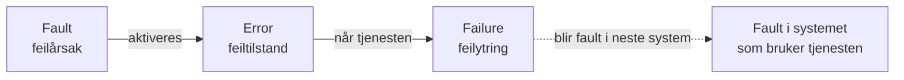

# Del III: Trusler, sårbarheter og feil

[PDF del 1](pdf/2026_lectures_part_III%20Threats-1.pdf) · [2](pdf/2026_lectures_part_III%20Threats-2.pdf) · [3](pdf/2026_lectures_part_III%20Threats-3.pdf)

**Hovedkilder:** PYSE-boka kap. 1 (fault–error–failure) og NOU 2015:13 kap. 7. Støttelitteratur: EkomROS 2021 og 2025, *Robust elektronisk kommunikasjon* kap. 4, og *Vår felles digitale grunnmur*.

## Regelverket: ekomloven

Ekomloven (ny lov i kraft 2024, forrige fra 2003) krever at tilbydere leverer nett og tjenester med **forsvarlig sikkerhet i fred, krise og krig**, holder nødvendig beredskap og prioriterer viktige samfunnsaktører. **Nkom** fører tilsyn. Loven skal være teknologinøytral fordi teknologien endrer seg raskere enn lovverket.

## Uønskede hendelser i ekom {#uonskede-hendelser-i-ekom}

Tilbydere må varsle Nkom om hendelser som kan redusere tilgjengeligheten vesentlig. De vanligste årsakene er **fiberbrudd**, **strømbrudd**, **maskinvarefeil** og **programvarefeil**. Uvær er ofte den underliggende årsaken til fiber- og strømbrudd, og graving er en vanlig årsak til fiberbrudd.

**Funn i EkomROS 2024:** endret trusselbilde, cybertrusler, sabotasje på infrastruktur på land og i sjø (fiberbrudd ved Andøya og Evenes), svak sikring i offentlig sektor, innsidetrusler og GNSS-forstyrrelser i Finnmark.

## Pålitelighetsblikket: fault → error → failure



| Begrep | Norsk | Betyr |
|---|---|---|
| **Fault** | feilårsak | Defekt i systemet (bug, maskinvarefeil) |
| **Error** | feiltilstand | Del av tilstanden som kan føre til feil; det synlige uttrykket for en fault |
| **Failure** | feilytring | Tjenesten avviker fra spesifikasjonen |

- **Fault dormancy:** tiden fra en fault oppstår til den blir en error. For programvare kan den være svært lang.
- **Error latency:** tiden fra error til failure.
- En **failure i ett system er en fault for systemet som bruker det**. Slik oppstår kjeder.

??? example "TCP er feiltolerant"
    En pakke går tapt (fault), meldingen mangler en bit når den settes sammen (error), men TCP oppdager tapet og sender på nytt. Dermed når feilen aldri brukeren som en failure på transportnivå.

**Typer fault:** fysiske, transiente, intermitterende, designfeil (Bohrbugs er reproduserbare, Heisenbugs/Mandelbugs er ikke), interaksjons- og driftsfeil, og miljøfeil.

## Sikkerhetsblikket: threat → vulnerability → incident

Her finnes det en **trusselkilde** (et menneske), ofte med en hensikt. En trussel utnytter en sårbarhet og gir en hendelse. Også her finnes dormancy og latency.

> Eksempel: et virus (trussel) infiserer en upatchet PC (sårbarhet), som blir ubrukelig (hendelse).

## Tre typer trusler

Emnet ser på alle tre samlet, fordi **kjeder av tilsiktede, utilsiktede og tilfeldige trusler** ofte gir de alvorligste følgene.

=== "Tilfeldige"
    - **Systemsvikt:** kortslutning, harddisker som dør, logiske feil, produksjonsfeil
    - **Naturhendelser:** storm, flom, skred, brann, solstorm
    - Eksempel: strømutfall i en ekomsentral i Ålesund i 2014 ga store avbrudd fordi alarmhåndteringen var mangelfull og adgangen til sentralen var elektrisk styrt.

=== "Utilsiktede"
    - Menneskelige feil: dokument til feil mottaker, feilkonfigurering, mislykket oppgradering, fiberkabel gravd over
    - «Mennesket er det svakeste leddet», men menneskelige feil er ofte et symptom på **organisatorisk svikt** (dårlig brukervennlighet, uklare rutiner)
    - Eksempel: Telenor 2011. Et forsøk på å rette en feil i mobildatanettet tok ned tale og SMS i hele landet i rundt 12–18 timer.

=== "Tilsiktede (angrep)"
    - Skadevare, man-in-the-middle, avlytting, rootkits, injeksjonsangrep, buffer overflow, passordangrep, (D)DoS, social engineering, tyveri, spionasje, sabotasje
    - Kan deles i **social engineering** og **tekniske angrep**, og i **målrettede** og **opportunistiske**

### Noen angrep i detalj

**Man-in-the-middle:** angriperen står i midten og videresender trafikk mellom to parter som tror de snakker direkte. Typiske metoder er falske Wi-Fi-punkter (evil twin), ARP- og DNS-spoofing. TLS med gjensidig autentisering motvirker det, men bare hvis brukerne tar sertifikatadvarsler på alvor.

**Buffer overflow:** programmet skriver mer data enn bufferen har plass til, og overskriver nabominnet. Angriperen kan da endre programflyten og kjøre egen kode. Typisk i C, C++ og assembly.

**SQL-injeksjon:** brukerinput sendes ufiltrert inn i en SQL-spørring.

```sql
-- normal
select * from users where user_id='ola' and password='hemmelig'
-- angrep: input gjør resten av betingelsen om til en kommentar
select * from users where user_id='' OR 1=1; /*' and password='*/--'
```

**Social engineering:** utnytter mennesker i stedet for teknologi, for eksempel phishing eller minnepinner lagt igjen på en parkeringsplass.

Trusselaktører bruker gjerne verktøy laget for personvern: Tor, kryptering og kryptovaluta.

## Sårbarheter

En sårbarhet er en **svakhet som lar en trussel føre til en hendelse**. Den kan være

- **kjent og akseptert**, fordi tiltaket koster mer enn skaden, eller
- **ukjent eller undervurdert**.

Mange sårbarheter er menneskelige eller organisatoriske, ikke tekniske (jf. MTO). Den enkleste sårbarheten å utnytte er **programvare som ikke er patchet**.

**Kjente lister:** OWASP Top 10 (injeksjon, brukket autentisering …), MITRE CWE Top 25 og NIST National Vulnerability Database.

### Sårbarheter i norsk ekom

- Mange aktører og mye tjenesteutsetting, så det er vanskelig å vite om noe faktisk er redundant
- Mer sentralisering, mindre lokal autonomi
- Ikke dimensjonert for trafikktopper under kriser
- **Lite redundans**, særlig i aksessnettet og for reservestrøm
- Kabler fra ulike operatører i samme grøft, antenner i samme mast

### Hvorfor er så mange IKT-systemer sårbare?

Internetts historie (bygd for robusthet mot tilfeldige feil, ikke for sikkerhet), kompleksitet, åpne nett, menneskelig drift, motstridende krav, begrensede ressurser, ny teknologi hele tiden, lange leverandørkjeder, og at organisasjoner er villige til å ta risikoen.

**Trender som øker sårbarheten:**

- **Fra fysiske til logiske nett:** SDN og virtualisering gir fleksibilitet, men mer komplisert programvare og konfigurasjon og nye feilkilder
- **Tjenesteutsetting og lange verdikjeder:** ansvaret flyttes, kunden mister kontroll og kompetanse, og det er vanskelig å oppdage og reagere på hendelser

## Modellering og analyse

| | Sikkerhet (angrep) | Pålitelighet (feil) |
|---|---|---|
| Strukturelle modeller | Angrepstrær, misbruksscenarier | Pålitelighetsblokkdiagram, feiltrær, cut sets |
| Dynamiske modeller | | Markov-modeller, Petri-nett |

## Repetisjon

??? question "Forklar med fault–error–failure hvorfor TCP er feiltolerant."
    Tapt pakke er fault, manglende data ved sammensetting er error. TCP oppdager tapet og retransmitterer, så det oppstår aldri en failure som brukeren ser.

??? question "Hvorfor holder det ikke å analysere bare angrep, eller bare tilfeldige feil?"
    De verste hendelsene er ofte kjeder av begge, for eksempel en uværsfeil som skjer samtidig med en feilkonfigurering, eller en skadevare som slår ut et sikkerhetssystem. Ser du bare på én type, overser du kombinasjonene.
