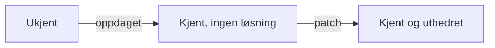

# Del IV: Trusler og trender innen IT-sikkerhet

[PDF](pdf/2026-Telenor%20Cyberpdf.pdf) · Telenor Cyberdefence, 08.09

Denne forelesningen fortsetter [del III](del-3-trusler.md): der del III gir begrepene, viser denne hvordan sårbarheter, angrep og trusselaktører ser ut i praksis.

## Sårbarheter

- **Teknisk alvorlighetsgrad ≠ risiko.** Alvorlighetsgrad (CVSS, 0–10) sier hva sårbarheten gir og hvor lett den er å utnytte. Risiko avhenger i tillegg av verdien til systemet og sannsynligheten for utnyttelse.
- **Kjente sårbarheter** får et CVE-nummer (f.eks. CVE-2017-0144 / MS17-010). Når de er kjent, er de lette å finne, derfor er patching viktig.
- **Ukjente (zero-day)** er svært vanskelige å beskytte seg mot: sikkerhetstesting, vulnerability disclosure-program, gode patcherutiner og sikkerhet i lag.
- Kjente zero-days: Heartbleed (2014), EternalBlue (2017, brukt i WannaCry og NotPetya), Log4Shell (2021), Ivanti EPMM (brukt mot DSS 2023).
- **AI** gjør det raskere og enklere både å finne og å utnytte sårbarheter.

### Livsløpet til en sårbarhet

Eksempel: HP iLO 4 (CVE-2017-12542, CVSS 10.0) ble oppdaget i februar 2017, patchet i august 2017 og offentlig kjent i februar 2018.

### Markedet for sårbarheter

| Marked | Eksempel | Mål |
|---|---|---|
| Hvitt | Bug bounty, responsible disclosure | Feilen fikses |
| Svart | Lukkede forum, dark web | Innbrudd og tyveri |
| Grått | Sårbarhetsmeglere, ofte med myndigheter som kunder | Overvåking, offensive operasjoner |

## Angrep

|  | Målrettet | Opportunistisk |
|---|---|---|
| **Teknisk** | Vanskelig mot oppdaterte systemer; utnytter feilkonfigurasjon, svak autentisering eller zero-days | Automatiske skannere (f.eks. Shodan) finner sårbare systemer; kryptering, defacement, kryptomining |
| **Social engineering** | Spear phishing | Phishing |

Angrep mot påloggingssystemer er blant de mest effektive målrettede angrepene. Opportunistiske angrep har økt mye med AI.

## Trusselaktører

| Aktør | Motiv | Eksempel |
|---|---|---|
| Innsidere | Fordel, hevn | Misfornøyde eller tidligere ansatte |
| Thrill seekers | Omdømme, nysgjerrighet | «Script kiddies», bruker nå mye AI |
| Hacktivister | Ideologi | Anonymous, Server Killers (DDoS mot Norge 2026) |
| Cyberkriminelle | Vinning | FIN7 (spear phishing, ransomware) |
| Statlige aktører | Politikk, spionasje | Lazarus (WannaCry, Sony), APT28 (Stortinget 2020, demning i Norge 2025) |

Statlige aktører er de mest avanserte, men angrep er ofte svært vanskelige å knytte sikkert til en stat.

## Repetisjon

??? question "Hvorfor kan en sårbarhet med CVSS 10 likevel gi lav risiko?"
    CVSS måler bare den tekniske alvorlighetsgraden. Hvis systemet har liten verdi, ikke er eksponert, eller ingen trusselaktør er interessert, blir sannsynligheten eller konsekvensen lav, og dermed også risikoen.

??? question "Hvorfor er perioden «kjent, men ingen løsning» spesielt farlig?"
    Da vet flere om sårbarheten, men det finnes ingen patch. Forsvareren kan bare redusere eksponering eller overvåke, mens angriperne har fått et mål.
