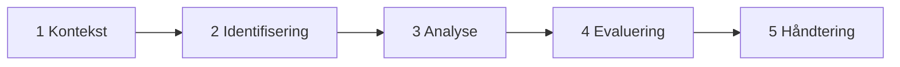

# Del V: Risikostyring

[PDF](pdf/2026_lectures_part_V%20Risk%20management.pdf)

**Kilder:** Jøsang, *Cybersikkerhet* (3. utg.), Refsdal/Solhaug/Stølen, *Cyber-Risk Management*, ISO/IEC 27005 og NSMs grunnprinsipper for IKT-sikkerhet.

## Grunnbegreper

| Begrep | Betyr |
|---|---|
| **Verdi** (asset) | Alt som har verdi for en interessent |
| **Uønsket hendelse** | Noe som skader eller reduserer verdien av en verdi |
| **Sannsynlighet** (likelihood) | Hvor trolig det er at noe skjer |
| **Konsekvens** | Virkningen av hendelsen på verdien |
| **Risiko** | Sannsynligheten for en uønsket hendelse og dens konsekvens for en verdi |
| **Risikonivå** | Størrelsen på risikoen, avledet av sannsynlighet og konsekvens |

**NSMs generelle modell:** jo større verdier, trusler og sårbarheter, desto større risiko. ISO/IEC 27005 definerer informasjonssikkerhetsrisiko som muligheten for at en trussel utnytter sårbarheter ved en verdi og dermed skader organisasjonen.

- **Risikostyring** er en kontinuerlig prosess for å styre en organisasjon med hensyn på risiko.
- **Risikovurdering** er en avgrenset aktivitet som gjøres jevnlig.

## Risikovurdering i fem steg

I praksis er ikke prosessen lineær; man går frem og tilbake. Standarden (ISO/IEC 27005) sier **hva** du skal gjøre, ikke **hvordan**.

### Steg 1: Kontekst (forberedelse)

- **Mål:** hvorfor gjør vi dette, og for hvem?
- **Omfang og antagelser:** hvilken del av systemet, hvilke brukere, hva er utenfor, hvem stoler vi på, hvor går tillitsgrensene, hva er angrepsflaten, hvilke tiltak finnes allerede. Dette tar ofte lengst tid.
- **Verdier:** *primære* (informasjon og tjenester) og *støttende* (programvare, maskinvare, nett, databaser, personell, lokaler). En støttende verdi kan erstattes; informasjonen den holder kan det ofte ikke.
- **Skalaer** for sannsynlighet og konsekvens, tilpasset organisasjonen. 3 til 10 nivåer er vanlig.
- **Akseptkriterier:** hvilket risikonivå er akseptabelt?

!!! example "Verdi i energisektoren"
    *Målerverdier* fra 1200 kunder i en sentral database er en primær verdi med høy verdi, fordi kompromittering kan gi mange feil fakturaer. Målerne, 4G-nettet, serveren og krypteringsnøklene er støttende verdier.

**Sannsynlighetsskala** kan beskrives med frekvens («flere ganger i året») og i tillegg med hvor godt tiltakene virker og hvilke ressurser en angriper trenger (Datatilsynets veileder). **Konsekvensskala** beskrives helst per verdi og dimensjon: nedetid, uautorisert innsyn, økonomisk tap, lovbrudd, omdømme. Den mest alvorlige dimensjonen bestemmer.

### Steg 2: Identifisering

Hva kan gå galt? Finn kombinasjoner av **trussel + sårbarhet + hendelse** som kan skade verdiene.

- **Hendelsesbasert (top-down):** tenk som angriperen
- **Verdibasert (bottom-up):** start med verdiene og sårbarhetene

**Metoder:** dokumentgjennomgang (policyer, konfigurasjon, logger, tidligere hendelser), testing (penetrasjonstest, sårbarhetsskanning) og intervjuer eller workshop med ulike interessenter. Hold fokus på omfang og verdier.

### Steg 3: Analyse

Estimer sannsynlighet og konsekvens for hver hendelse med skalaene fra steg 1, og **dokumenter alltid hvorfor**.

- **Sannsynlighet:** hvem vil gjøre dette, og hvorfor? Hvilke ressurser trengs? Hvilke sårbarheter og tiltak finnes? Hvilke tilfeldige feil kan skje?
- **Konsekvens:** brudd på K, I, T eller personvern. Tap, svekket tjeneste, juridiske følger, omdømme, gjenopprettingskostnad, liv og helse.

> **R1:** Et virusutbrudd gjør serverdata utilgjengelige. *Lite sannsynlig* fordi antivirus finnes, *moderat* konsekvens fordi det finnes en offline backup som raskt kan startes.

### Steg 4: Evaluering

Plasser risikoene i matrisen og sammenlign med akseptkriteriene.

<table>
<thead><tr><th>Konsekvens ↓ · Sannsynlighet →</th><th>Sjelden</th><th>Lite sannsynlig</th><th>Mulig</th><th>Sannsynlig</th><th>Sikker</th></tr></thead>
<tbody>
<tr><th>Kritisk</th><td class="y"></td><td class="r"></td><td class="r"></td><td class="r"></td><td class="r"></td></tr>
<tr><th>Stor</th><td class="g"></td><td class="y"></td><td class="r"></td><td class="r"></td><td class="r"></td></tr>
<tr><th>Moderat</th><td class="g"></td><td class="y"><strong>R1</strong></td><td class="y"></td><td class="r"></td><td class="r"></td></tr>
<tr><th>Liten</th><td class="g"></td><td class="g"></td><td class="y"></td><td class="y"></td><td class="r"></td></tr>
<tr><th>Ubetydelig</th><td class="g"></td><td class="g"></td><td class="g"></td><td class="g"></td><td class="y"></td></tr>
</tbody>
</table>

*Eksempelmatrise. Fargene er organisasjonens eget valg og trenger ikke være symmetriske.* Grønn = akseptabel, gul = bør reduseres hvis det ikke er for dyrt, rød = uakseptabel.

### Steg 5: Håndtering

| Strategi | Betyr |
|---|---|
| **Redusere** | Sett inn tiltak som senker sannsynlighet og/eller konsekvens (vanligst) |
| **Overføre** | La andre bære risikoen: forsikring (cyberforsikring) eller tjenesteutsetting |
| **Akseptere** | Lev med den, når tiltak koster mer enn de sparer |
| **Unngå** | Ikke gjør aktiviteten (siste utvei, du mister også nytten) |

Ta også de «lavthengende fruktene»: billige tiltak selv på lave risikoer.

!!! example "Tiltak mot skadevare som gjør serverdata utilgjengelige"
    - Antivirus → senker både sannsynlighet og konsekvens
    - Sikkerhetsopplæring → senker sannsynlighet
    - Hyppig backup → senker konsekvens
    - Redundant server (stand-by) → senker konsekvens

**Typer tiltak:** forebyggende, avdekkende og korrigerende; administrative, tekniske og fysiske; feilunngåelse og feiltoleranse (pålitelighet); fail-safe (safety); dimensjonering og overvåking (ytelse).

## Når skal man gjøre en ny risikovurdering?

Med faste mellomrom (f.eks. årlig), når systemet endres (flytting til sky, ny tjeneste) og når omgivelsene endres (nye trusler).

## Kvalitativ eller kvantitativ

- **Kvalitativ:** «Tyveri av laptop er lite sannsynlig og har moderat konsekvens.» Mest vanlig.
- **Kvantitativ:** «5 % sannsynlighet for tyveri, koster 3000 USD å erstatte.»

## Risikovurdering av komplekse systemer

Det er vanskeligere enn man tror: systemene endrer seg hele tiden, det er mange interessenter, innsidere er vanskelige å forutse, dominoeffekter er uforutsigbare, og ofte har ingen full oversikt over systemet.

**Tilpasninger:**

- Del identifiseringen i **tilsiktede**, **utilsiktede** og **tilfeldige** risikoer (steg 2a, 2b, 2c)
- **Del opp risikoer** i en alvorlig og en mindre alvorlig variant i stedet for å bare se på verste tilfelle

**Usikkerhet:** *epistemisk* (mangel på kunnskap, kan reduseres) og *aleatorisk* (iboende tilfeldighet). Risiko er ikke eksakt vitenskap, men diskusjonene underveis er verdifulle i seg selv.

## Tjenesteutsetting, SLA og avtaler

**Fordeler:** ofte bedre sikkerhet, mer stabile og skalerbare tjenester, tilgang på ekspertise, forutsigbare kostnader, fokus på kjernevirksomheten. **Ulempen:** du må stole på en tredjepart.

Risikovurderingen bør da også se på hvor data lagres og behandles, hvor utstyr og personell er, hvem som har tilgang, hendelseshåndtering og bruk av underleverandører.

| Avtale | Mellom | Regulerer |
|---|---|---|
| **SLA** (Service Level Agreement) | Bruker og tilbyder | Tjenestebeskrivelse, tjenestenivå (SLO), overvåking, håndtering, kompensasjon ved brudd, oppsigelse |
| **ToU** (Terms of Use) | Tilbyder og bruker | Regler for bruk, ansvar, misbruk (juridisk bindende) |
| **DPA** (databehandleravtale) | Behandlingsansvarlig og databehandler | At personopplysninger behandles lovlig også etter utsetting |

## Motstridende krav

Det vanligste er **safety mot security** og **tilgjengelighet mot konfidensialitet**. Først må konflikten oppdages, så løses. Ofte vinner én egenskap (safety er nesten alltid øverst), men ofte finnes en mellomvei.

!!! example "Flytrafikkledelse"
    - Security: «Vi trenger tofaktorautentisering.» Safety: «Skjermene må alltid være ulåste.»
    - Security: «ADS-B-meldingene bør krypteres.» Safety: «ADS-B-meldingene må sendes i klartekst.»

## Repetisjon

??? question "Hva er hovedargumentet for å utlede sikkerhetskrav fra en risikovurdering?"
    Ressursene er begrenset, og ingen systemer kan sikres 100 %. Risikovurderingen viser hvilke verdier og hendelser som betyr mest, så kravene treffer de største risikoene først.

??? question "Hvorfor er det ofte nyttig å dele én risiko i en alvorlig og en mindre alvorlig variant?"
    En hendelse kan ha svært ulike utfall. Ser du bare på verste tilfelle, overvurderer du det vanlige utfallet; ser du bare på det vanlige, overser du det alvorlige. To varianter gir hver sin plass i matrisen og riktigere tiltak.
